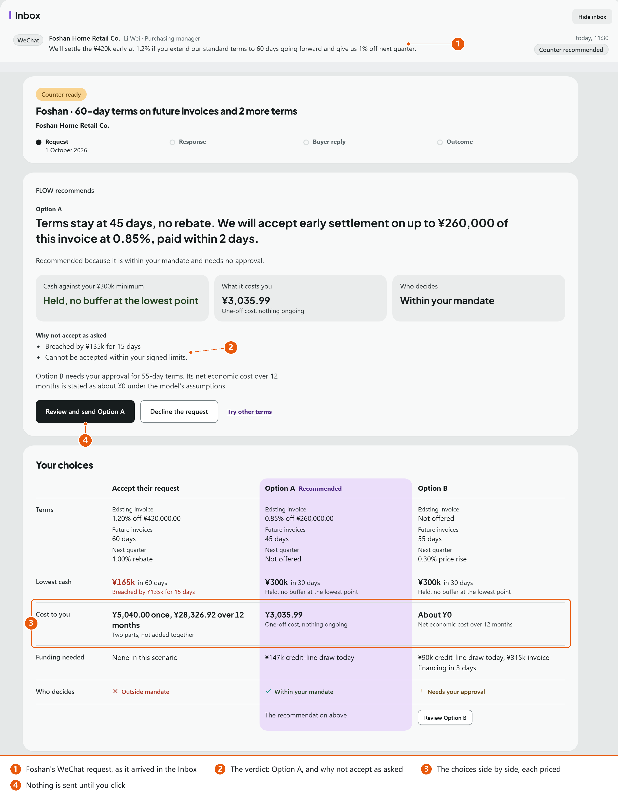
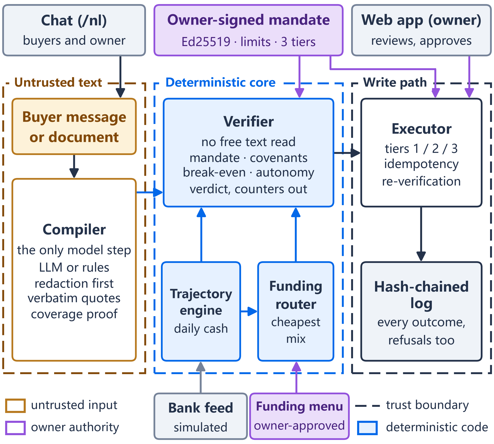

<div align="center">

# FLOW

**An AI working-capital agent that works for a small supplier, not for its bank or its buyers.**

FinTechathon 2026 · International AI Track · Topic E: SME Finance Copilot · Team ISMOGGER

`Python 3.12` · `FastAPI` · `Next.js 16` · `TypeScript` · `SQLite / PostgreSQL` · `English and Chinese`

</div>

> **A working simulation.** The engine, the agent, the security controls and the web app are real code. The buyers, the
> lenders and the bank feed are simulated, all data is synthetic (`fixtures/`), and no real money moves. FLOW is decision
> support under the owner's own signed limits, not a lender, broker or adviser.



<sub>A buyer asks for 60-day terms, a 1.2% early-payment discount and a rebate. FLOW shows why the package cannot be accepted
as asked, prices two counter-offers, and sends nothing without the owner.</sub>

**Contents:** [Quickstart](#quickstart) · [What it does](#what-it-does) · [Architecture](#architecture) ·
[Results](#results-at-a-glance) · [Deliverables](#deliverables) · [Repository layout](#repository-layout) ·
[Testing](#testing) · [Security](#security) · [Known limitations](#known-limitations) ·
[Reference](#reference) · [Documentation map](#documentation-map) · [Team and licence](#team-and-licence)

> **Names.** The product is **FLOW**. The code and package names still say **TermsLedger** (`termsledger`,
> `termsledger-api`, `TERMSLEDGER_*` variables, the `termsledger.db` file): it is the same system.

## Quickstart

**Prerequisites**

| Tool | Version | Used for |
| --- | --- | --- |
| [uv](https://docs.astral.sh/uv/) | any recent | runs the API; installs Python **3.12** for it (`services/api/.python-version`; `pyproject.toml` allows 3.12 and 3.13) |
| Node.js | 22 or newer (CI uses **24**) | the web app and the launcher |
| pnpm | CI uses **12.11.2** | the web app's packages |

No version is pinned in `package.json` (no `engines` or `packageManager` field); the versions above are the ones
`.github/workflows/checks.yml` runs. No API key and no network are needed after installation: the default `LLM_MODE=cache`
replays recorded model readings and falls back to a deterministic rules grammar.

**Run it** (the same commands in PowerShell, cmd, macOS and Linux, from the repository root):

```bash
git clone https://github.com/peachoolongtee/smu2sz.git
cd smu2sz
pnpm --dir apps/web install     # once: the web app's packages

pnpm demo                       # API on :8000 and web app on :3000 against it
```

Open **http://localhost:3000** when the launcher prints `Ready`. The owner sign-in is prefilled with the local demo token
(`demo-owner-token`). The first run also installs the API's Python packages, which takes a minute or two.

| Command | What it starts |
| --- | --- |
| `pnpm demo` | The API with in-memory demo books, recorded model readings and the demo credentials, then the web app against it |
| `pnpm demo:keep` | Like `pnpm demo`, but the books live in a local SQLite file (`.demo-data/flow-demo.db`, git-ignored), so what you upload, confirm or book survives a restart |
| `pnpm demo:keep --fresh` | The same, deleting that file first to start again from new demo books |
| `pnpm demo:blank` | A new business with no books, opening on the setup wizard (combine with `--keep` to keep them) |
| `pnpm demo:mock` | The web app alone on recorded API answers: no API and no Python needed |
| `pnpm demo --web-port 3141 --api-port 8041` | Other ports, if 3000 or 8000 is taken (the API is told to allow the new web origin) |

The launcher (`scripts/demo.mjs`, Node only; `node scripts/demo.mjs --help` lists every option) checks both ports first and
never stops another program, waits for the API before starting the web app, and stops both on Ctrl+C. It runs the API with
`DATABASE_URL=memory` (or the `--keep` file), `TERMSLEDGER_NO_DOTENV=1` so a repo-root `.env` is ignored, `DEMO_MODE=1`,
`LLM_MODE=cache` and the feature flags on, the default-off ones included: the three strategy answers (`FEATURE_ENVELOPE`,
`FEATURE_PRICE_CURVE`, `FEATURE_COLLECTIONS_WORTH`), `FEATURE_EXPOSURE`, `FEATURE_CAPEX_CONTRACTS` and `FEATURE_CONTRACT_TERMS`.
The web app is built with `NEXT_PUBLIC_STRATEGY_MVP=1`, so the price of earlier cash shows on Cash & funding (read-only; it
changes no books). Two strategy surfaces stay hidden in the demo:

- **The Safe Deal Envelope** on a deal's Cash impact ("The most you can give", "What you could answer instead";
  `NEXT_PUBLIC_STRATEGY_ENVELOPE=1` on the web). Its first read of a set of books repeats the funding search dozens of times:
  about 17 s on the demo books and 30 s to 80 s on the busy books, at or past the 20 s the web waits. It shows once that read
  is faster; the API route stays on, so `GET /buyers/BUYER-1/envelope` answers.
- **The pilot journal** (`FEATURE_PILOT_JOURNAL`, `NEXT_PUBLIC_PILOT_JOURNAL`): the shadow pilot's record of real owners'
  decisions, not part of the demo (`docs/pilot/RUNBOOK.md`).

In the app, switch to **Demo** in the header to follow the scripted story, or use the Business pages directly (Home, Deals,
Attach deals, Cash & funding, Sandbox, Capex, Receivables, Activity). **Ask FLOW** opens the chat from every page.

**"localhost refused to connect"** means nothing is listening on that port, or the web app came up on a port the API does not
allow. Run `pnpm demo` and open the address it prints; if it says a port is taken, pass `--web-port` / `--api-port`.

**No browser at all.** One command runs the evaluation a judge needs, offline and deterministic, and writes a readable report
to `services/api/evals/judge/judge-report.md` (and `.json`):

```bash
uv run --project services/api python scripts/judge_eval.py
```

It runs the 49 scripted conversations, the 259-attack catalogue, the 17-step demo walk, and a hash-chain check of the walk's
log together with a tampered copy that must fail; it exits non-zero on any failure. Eight questions to ask FLOW live, with the
exact input and the real answer, are in [`docs/deliverables/JUDGING_QUESTIONS.md`](docs/deliverables/JUDGING_QUESTIONS.md).

## What it does

FLOW controls both of a small supplier's debt books under a mandate the owner signs. **Terms Guard** covers the credit the
supplier *gives* its buyers through payment terms, discounts and rebates. **Debt Desk** covers the credit it *takes* from
lenders to survive those terms. They share one financial model, so a concession is priced at the supplier's real marginal
cost of borrowing.

1. **Reads** a buyer's message or contract, in Chinese or English, into typed terms, each tied to the exact words it came from.
2. **Prices it in cash:** projects daily cash, debt and future promises with and without the request.
3. **Decides within the owner's signed limits:** a verdict with the failing rule, the figures and the formula, plus priced
   counter-offers that keep the business safe.
4. **Arranges funding:** the cheapest admissible plan from the owner's own committed facilities, with covenants checked.
5. **Follows through:** watches for late or partial payment, warns the owner first, proposes a cure inside the limits with
   its cost, and closes the loop when the money lands.

FLOW may accept a buyer's offer on its own only when it can prove it accounted for every figure and request in it
([ADR-0005](docs/adr/0005-autonomy-requires-proof.md)); everything else goes to the owner. Free text executes only as one
closed affirmative command, and a plan runs only on the owner's "go ahead", as exactly the operations shown.

**The demo story** (golden books, `scripts/demo_run.py`):

1. Foshan Home Retail asks for 60-day terms, a 1.2% early-payment discount and a rebate. FLOW rejects the package as asked
   and offers two priced counters.
2. The buyer accepts Option A, early payment on up to ¥260,000 of its invoice at 0.85%, and pays ¥257,790.00 on day 2.
3. Day 34: the rest of the invoice is late and cash is heading under the reserve. FLOW speaks first and proposes a ¥200,000
   invoice advance costing ¥1,782.19.
4. That is 32.5% a year, above the owner's 15% ceiling, so "go ahead" only queues it. The owner's approval runs it, and the
   cash lands on day 37.
5. The late money arrives, the advance is repaid, reconciliation closes the deal, and the record's hash chain verifies.

## Architecture



FLOW is a modular monolith: one FastAPI service ([`services/api`](services/api), Python 3.12), one Next.js 16 web app
([`apps/web`](apps/web), TypeScript) and one database (SQLite or in-memory locally, PostgreSQL in deployment). Modules talk
only through typed contracts in `services/api/app/domain/`.

- **The compiler is the only model-backed step.** It turns untrusted text into typed obligations with source spans, or
  abstains. It never sees the books, the mandate or the funding options.
- **The deterministic core decides.** The engine, router and verifier project the trajectory, price the gap and return the
  verdict; the verifier cannot read free text (a test enforces its imports).
- **Only the executor writes.** It runs Tier 1, queues Tier 2 for the owner, refuses Tier 3, and appends every outcome to a
  **hash-chained log** that anyone can verify (`scripts/verify_evidence.py`).
- **The browser computes no money and no dates.** Every figure and sentence comes from the server, in English and Chinese.

Full detail: the [technical document](docs/deliverables/technical_document.md) (section 02) and
[`docs/ARCHITECTURE.md`](docs/ARCHITECTURE.md).

## Results at a glance

Build `dev` at `975e082f`, 17 Oct 2026, offline (`LLM_MODE=cache`, in-memory store). Every figure is quoted from
[`docs/deliverables/evidence/EVIDENCE_PACK.md`](docs/deliverables/evidence/EVIDENCE_PACK.md), which gives the command and
the source for each.

| Area | Result |
| --- | --- |
| Engine correctness | Financial values exact to the fen against an independent oracle: **67/67**; covenant and capex values **27/27** |
| Funding router | Optimal against an exhaustive brute force: **26/26** scenarios (runnable and priced) |
| Safety of autonomy | **0 wrong autonomous accepts** on two held-out sets (115 buyer messages) |
| Usefulness of autonomy | **3 of 14** economically eligible early-pay offers handled on its own; the other **11** go to the owner for one review |
| Security | **259 attacks** (126 through the API, 133 through chat), **0 caused harm**; 98.41% of the API attacks detected |
| Agent tasks | **49/49** scripted conversations (87 turns), each with an evidence chain |
| Demo walk | 17 steps; audit chain **VALID** (14 operations); a tampered copy is rejected |
| API tests | **9,085** collected; **9,040** passed; the one failure is **#161**, a hash that differs by machine |
| Web and browser tests | **169** web unit tests; Playwright **445** mock passed, 0 failed; **139** live passed (known failures `live.spec:333` and `:347`) |
| Offline evaluation | `scripts/evaluate.py` completed in 7 min 41 s with 0 targets missed in every suite |
| Chinese contract reading | 75% on a held-out batch, 86% after fixes, 98% on the tuned batch (measured in session on 17 Oct, cache replay of recorded DeepSeek readings; not a committed report) |

Where FLOW falls short is stated beside these figures in the technical document (section 03) and in the evidence pack.

## Deliverables

| Deliverable | Source | Built |
| --- | --- | --- |
| Technical document | [`technical_document.md`](docs/deliverables/technical_document.md) | [`Technical_Document.docx`](docs/deliverables/out/Technical_Document.docx) |
| Execution evidence | [`execution_evidence.md`](docs/deliverables/execution_evidence.md), [evidence files](docs/deliverables/evidence/README.md), [evidence pack (17 Oct)](docs/deliverables/evidence/EVIDENCE_PACK.md) | [`Execution_Evidence.docx`](docs/deliverables/out/Execution_Evidence.docx) |
| Security self-assessment | [`SECURITY_SELF_ASSESSMENT.md`](docs/SECURITY_SELF_ASSESSMENT.md) | [`Security_Self_Assessment.docx`](docs/deliverables/out/Security_Self_Assessment.docx) |
| Test cases | [`TEST_CASES.md`](docs/deliverables/TEST_CASES.md) | |
| Figures | [`figures/`](docs/deliverables/figures/README.md) (PNG, with their matplotlib sources) | |
| Screenshots | [`screenshots/`](docs/deliverables/screenshots/README.md) (annotated and raw) | |
| Demo video script, deck outline | [`demo_video_script.md`](docs/deliverables/demo_video_script.md), [`deck_outline.md`](docs/deliverables/deck_outline.md) | |
| Judging questions | [`JUDGING_QUESTIONS.md`](docs/deliverables/JUDGING_QUESTIONS.md) | |

Rebuild the `.docx` files with `uv run --project services/api python scripts/build_deliverables.py` (add
`--refresh-evidence` to regenerate the evidence first).

## Repository layout

```text
apps/web/        Next.js 16 web app: Business pages, the Demo story, Ask FLOW, recorded mocks, Playwright specs
services/api/    FastAPI service: compiler, engine, router, verifier, executor, chat harness
  app/             the modules (one folder each), typed contracts in app/domain/
  tests/           the API test suite (pytest)
  evals/           evaluation reports: offline suites, held-out sets, attacks, scripted tasks, judge pack
  migrations/      Alembic migrations for PostgreSQL deployments (head 0009)
fixtures/        synthetic data: golden books and oracle values, offers, held-out sets, contracts, recorded model readings, demo keys
scripts/         demo launcher, demo walk, evaluations, judge pack, evidence verification, deliverables build
infra/           docker-compose.yml, API and web Dockerfiles, .env.example
docs/            architecture, ADRs, security self-assessment, deliverables, handover
CONTEXT.md       glossary of the domain terms
PRODUCT.md       product brief: users, purpose, open questions
AGENTS.md        instructions for coding agents working in this repository
```

## Testing

Run each command from the directory named. The full catalogue, with what each suite proves, is
[`docs/deliverables/TEST_CASES.md`](docs/deliverables/TEST_CASES.md).

```bash
# API (services/api): needs no environment variables; tests/conftest.py sets TERMSLEDGER_NO_DOTENV=1 and DEMO_MODE=1
cd services/api && uv run pytest                                # full suite; SKIP_PERF_BENCH=1 skips the timing benchmarks
cd services/api && uv run pytest tests/mandate tests/verifier   # one area

# Web (apps/web)
cd apps/web && pnpm typecheck && pnpm lint && pnpm test:unit

# Browser tests (apps/web, Playwright)
cd apps/web && pnpm exec playwright install chromium            # once
cd apps/web && pnpm test:e2e:mock                               # desktop and phone projects on a mock build (:3100); no backend
cd apps/web && pnpm test:e2e:live                               # live project: starts its own in-memory API (:8000) and web build (:3000)

# Evaluation (repository root)
uv run --project services/api python scripts/judge_eval.py                     # the judge pack: tasks, attacks, demo walk, chain check
DEMO_MODE=1 uv run --project services/api python scripts/evaluate.py           # every offline suite, including the funding brute force
DEMO_MODE=1 uv run --project services/api python scripts/evaluate.py --suite offers --heldout fixtures/heldout3   # a held-out set
uv run --project services/api python scripts/run_scenarios.py --inproc         # the 49 scripted tasks and their evidence chains
cd services/api && uv run python -m app.security.attacks --report              # the 259-attack catalogue
DEMO_MODE=1 PYTHONUTF8=1 uv run --project services/api python scripts/demo_run.py   # the 17-step demo walk, no UI
```

`E2E_PORT`, `E2E_LIVE_PORT` and `E2E_API_PORT` move the Playwright servers; the other switches are in
[`apps/web/README.md`](apps/web/README.md#tests). **Verify an evidence chain** with the standard library only:
`python scripts/verify_evidence.py <file.jsonl>` recomputes every `entry_hash = sha256(prev_hash + payload_json + result_json)`.

## Security

The language model only reads text; deterministic code decides, and only the executor writes. Actions are split into three
permission tiers under an owner-signed, expiring mandate, with nonces, idempotency, a circuit breaker and a hash-chained log.
The [Security Self-Assessment](docs/SECURITY_SELF_ASSESSMENT.md) (v2.0, 17 Oct 2026, assessed on `dev` at `719c9dcf`) gives
the verdicts:

| Use | Verdict |
| --- | --- |
| Local simulation on loopback (`DEMO_MODE=1`, cache mode, simulated counterparties) | **GO** |
| Demo reachable over a network | **conditional GO**: changed credentials, a TLS reverse proxy with rate and body limits, documentation hidden |
| Production with real customers, documents or money | **NO-GO** |

The published demo credentials work only with `DEMO_MODE=1`, which is off by default. The mandate in `fixtures/keys/` is
signed with a published key labelled DEMO ONLY.

## Known limitations

- **Everything outside FLOW is simulated:** lenders, buyers, rates and the bank feed. No real money moves.
- **Recorded readings by default.** A new document gets the rules reading unless live mode (`LLM_MODE=live`, with a model
  key) is on. The language-boundary certification has not yet been run against a live model.
- **Autonomy is cautious.** Good early-payment offers that state a settlement date go to the owner, because the date is not yet
  read into the terms.
- **Contracts:** text-layer documents only; scans and photos are refused (no OCR). Confirming a contract changes no books.
- **Not production-ready:** no runnable production configuration (SEC-06), one worker process only (SEC-11), single-operator
  key custody, and the hash-chain head is not anchored outside the system.
- **`pnpm demo` forgets on restart** (in-memory books); use `pnpm demo:keep` to keep them.

The full list is in the [technical document](docs/deliverables/technical_document.md#environment-deployment-instructions-test-cases-and-known-limitations)
(section 05) and the [Security Self-Assessment](docs/SECURITY_SELF_ASSESSMENT.md).

## Reference

### Running by hand

Two terminals (bash syntax; in PowerShell set each variable with `$env:NAME="value"` first). Always set
`TERMSLEDGER_NO_DOTENV=1` and `DATABASE_URL=memory`, or the API reads a repo-root `.env` and opens a SQLite file:

```bash
# terminal 1, from services/api
TERMSLEDGER_NO_DOTENV=1 DATABASE_URL=memory DEMO_MODE=1 LLM_MODE=cache CORS_ORIGINS=http://localhost:3000 \
  FEATURE_ENVELOPE=1 FEATURE_PRICE_CURVE=1 FEATURE_COLLECTIONS_WORTH=1 \
  uv run uvicorn app.main:app --port 8000
# terminal 2, from apps/web
NEXT_PUBLIC_API_URL=http://localhost:8000 pnpm dev:live      # or: pnpm dev:mock, for the recorded mocks alone
```

`pnpm dev:live` builds with the strategy answers on (`NEXT_PUBLIC_STRATEGY_MVP=1`), so the API needs their flags, as above;
without them those reads answer 403 and the browser console reports each one.

- **Where the data lives.** Without `DATABASE_URL` the API uses `termsledger.db` in the directory it was started from
  (git-ignored) and creates its tables on the first request; no Alembic step is needed locally. `DATABASE_URL=memory` writes no
  file. For another file, use the absolute form `sqlite:////absolute/path/to/file.db` (four slashes).
- **Other ports.** Start the API with `CORS_ORIGINS=<web origin>` and the web app with `NEXT_PUBLIC_API_URL=<API origin>`;
  `pnpm demo --web-port <n> --api-port <n>` does both for you.
- More on the web app's modes, sign-in and mocks: [`apps/web/README.md`](apps/web/README.md).

### Configuration

| Variable | Meaning |
| --- | --- |
| `DEMO_MODE` | `1` accepts the published demo credentials, seeds the demo books and enables the demo routes. Off by default |
| `DATABASE_URL` | `memory`, a SQLite URL (default `sqlite:///./termsledger.db`) or a `postgresql+psycopg://` URL |
| `LLM_MODE` | `cache` (default) replays recorded readings; `live` calls a model and needs `ANTHROPIC_API_KEY` or `DEEPSEEK_API_KEY` |
| `LLM_PRIMARY` | `claude` (default) or `deepseek` |
| `TERMSLEDGER_NO_DOTENV` | `1` skips the repo-root `.env` |
| `FEATURE_*` | feature flags (`1` on, `0` off), listed with their defaults in `services/api/app/config.py`; a disabled feature returns `FEATURE_DISABLED` |

| Credential | Header | Variable | Local demo value (only with `DEMO_MODE=1`) |
| --- | --- | --- | --- |
| Owner token | `X-Owner-Token` | `OWNER_TOKEN` | `demo-owner-token` |
| Agent key | `X-Agent-Key` | `AGENT_KEY` | `demo-agent-key` |
| Bank-feed key | `X-Bank-Feed-Key` | `BANK_FEED_KEY` | `demo-bank-feed-key` |

### Deployment (not production-ready)

`infra/docker-compose.yml` runs `postgres`, `api` (built from `infra/api.Dockerfile`) and `web` (built from
`infra/web.Dockerfile`), with `DEMO_MODE: "0"` hard-coded and the API bound to `127.0.0.1:8000` behind a TLS reverse proxy.
Secrets come from `infra/.env` (copy [`infra/.env.example`](infra/.env.example); never commit it).

```bash
docker compose -f infra/docker-compose.yml up -d postgres
docker compose -f infra/docker-compose.yml run --rm api uv run --no-dev alembic upgrade head   # migrations 0001 to 0009, before the first start
docker compose -f infra/docker-compose.yml up -d --build
```

Migration `0002` enables row-level security and `0003` and `0009` make the log append-only in the database itself; a database
the app created for itself has neither. **This does not yet produce a working API (SEC-06):** the owner's public signing key
(`OWNER_PUBLIC_KEY_HEX`) is not passed in, nothing provisions the books and the signed mandate, and the web image is built
against `http://localhost:8000`. The supported way to run FLOW is the local launcher. For an evaluation stack on a private
network, follow the conditions in the [Security Self-Assessment](docs/SECURITY_SELF_ASSESSMENT.md).

### Data and compliance

In live mode (opt-in) a buyer's message and documents go to the configured model provider for extraction only, after
redaction of accounts, phone numbers, e-mail addresses, IDs and labelled addresses; the model never receives the mandate,
the reserve, facility limits or other buyers' terms. In the default cache mode nothing leaves the machine. Real buyer
documents can contain personal information: production use would need a legal basis under China's PIPL and, where required,
a security assessment or standard contract. That is an obligation on a deployer, not legal advice, and we do not claim
compliance.

## Documentation map

| Document | What it holds |
| --- | --- |
| [`CONTEXT.md`](CONTEXT.md) | The glossary: owner, mandate, reserve, obligation, facility, tiers |
| [`docs/ARCHITECTURE.md`](docs/ARCHITECTURE.md) | Modules, contracts, engine and verdict rules, the API |
| [`docs/adr/`](docs/adr) | Architecture decisions: storage, rounding, timing, evidence, autonomy, current books and clock, early payment, DSCR, contracts, capex |
| [`docs/FINANCIAL_SEMANTICS.md`](docs/FINANCIAL_SEMANTICS.md) | The financial rules |
| [`docs/INVARIANTS.md`](docs/INVARIANTS.md) | The security laws |
| [`docs/DEMO_FLOW.md`](docs/DEMO_FLOW.md) | The scripted demo and its numbers |
| [`docs/SYSTEM_WALKTHROUGH.md`](docs/SYSTEM_WALKTHROUGH.md) | A walk through the whole system |
| [`docs/SECURITY_SELF_ASSESSMENT.md`](docs/SECURITY_SELF_ASSESSMENT.md) | Permission model, attack results, privacy, risk register |
| [`docs/HANDOVER.md`](docs/HANDOVER.md), [`docs/NEXT_FIXES.md`](docs/NEXT_FIXES.md) | Current state, standing instructions and the live tracker |
| [`docs/agents/integration.md`](docs/agents/integration.md) | Branching and integration rules for contributors |
| [`services/api/evals/accuracy_summary.md`](services/api/evals/accuracy_summary.md) | What we claim about the compiler, and what we do not |

## Team and licence

Built by **Team ISMOGGER** for FinTechathon 2026 (International AI Track, Topic E), submitted 20 October 2026.

Licence: to be decided by the team. There is no `LICENSE` file yet, so no licence is granted.
