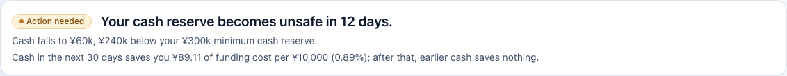

# The comprehension test of the cash price sentence

For wayfinder map [#58](https://github.com/peachoolongtee/smu2sz/issues/58). It decides one gate of
`docs/STRATEGY_RESEARCH.md` section I:

| Capability | Passes the gate when | Killed when |
| --- | --- | --- |
| Cash price curve | three of three owners in the comprehension test explain "0.89%" as what earlier cash is worth to them, not a rate charged | any owner reads it as a charged rate (reword and retest once; then kill) |

Why it exists: the sentence first read "worth 0.89% to you", and the first cold reader took that for a rate charged. It was
reworded to lead with yuan; this test is the second reading, on the people it is for.

## The sentence, as an owner sees it

*(`docs/pilot/img/cash-sentence.png`: the status card at the top of Cash & funding, recorded from the mock build with the
strategy flag on, on the demo's synthetic books. The sentence is the last line: "Cash in the next 30 days saves you ¥89.11
of funding cost per ¥10,000 (0.89%); after that, earlier cash saves nothing.")*

Show the owner **the picture, or the live page at `/cash` with the same card**, not the sentence typed in a chat. The
figures in it are synthetic, so no real data is shown; if an owner asks "is that my business?", say it is an example.
To show the sentence for the owner's own SME instead, use a pilot week's `cash.png`: record which one was shown.

## Who and how

- **Three owners** of small suppliers that sell on payment terms, named on grilling
  [#59](https://github.com/peachoolongtee/smu2sz/issues/59). Not the pilot owners if they have already read the sentence in a
  weekly session (they have seen FLOW; the test needs a cold reading). A finance manager is not a substitute for an owner.
- **One at a time**, in person or on a call with the screen shared. Not in a group: they must not hear each other's answers.
- **One interviewer** reads the script; **a second person**, if there is one, only writes. The interviewer is not the person
  who wrote the sentence.
- About five minutes each. Language: the one the owner works in. The Chinese sentences await a native reader, so run the
  English test in English, and a Chinese test only with the Chinese wording the lead has approved, recorded in the table.

## The script (read exactly)

1. "Thank you. I am going to show you one sentence from a cash planning tool. There is no right answer and I am not testing
   you: I am testing the sentence. I will not explain it, and I will not tell you if you are right."
2. Show the sentence. Say nothing for as long as it takes them to read it. Do not point at the number.
3. Ask the one question, exactly:

   > **"In your own words, what does this sentence tell you?"**

4. Write down their answer **word for word**, as they say it, in their language. Do not prompt, nod at a keyword or complete
   their sentence. If they ask "what does it mean?", answer only: "What does it look like it means to you?"
5. When they stop, ask once: "Anything else?" Write that down too.
6. Then, and only then, one neutral follow-up, recorded separately and never used to pass or fail: "In that sentence, is the
   0.89% something you receive, something you pay, or something else?"
7. Thank them. Do not tell them how they did.

## The pass rule

Coded from **the answer to the one question** (steps 3 to 5), by the interviewer and a second reader independently, then
agreed. The follow-up in step 6 is a note, not a score.

- **Pass:** the reader describes a **saving or a value to them**: getting the money earlier is worth about that much; it saves
  them that much funding cost; "I save about ¥89 on every ¥10,000 if it arrives in the next month". The figure need not be
  exact, and calling it a percentage of the cash is fine **if it is what the earlier cash is worth**.
- **Fail:** the reader describes **a rate charged**: that 0.89% is an interest rate, a fee, a discount they must give, a
  charge from the tool or a bank, a cost they pay; or that the amount is added to what they owe.
- **Unclear:** the answer is neither ("it's about cash timing", "it's a calculation", a repeated reading of the words). Code it
  *unclear*, write down why, and count it as **not a pass** for the gate (three of three must pass) but **not a kill** by
  itself. Two unclear answers on a first wording trigger the same reword as one fail, at the lead's discretion, and the record
  says which.

## The reword-once-then-kill rule

1. If **any** owner fails (reads a rate charged), the sentence is **reworded once**. The lead writes the new wording, in
   business words, and enters it in the "Wording" column of the retest table **before** any retest. The new wording changes
   the sentence, not the figures: every yuan figure and percentage stays exactly the one FLOW computes (INVARIANT 13).
2. The retest uses **three owners who have not read the first wording**, where three can be found. If not, the same owners are
   used and the record says so, because they are no longer cold: a pass from them is weaker evidence, and a fail kills.
3. **Three of three pass on the second wording** (the first wording failed and the second passes): the sentence passes the gate
   on the second wording and that wording is the one to ship.
4. **Any owner fails on the second wording:** the sentence is killed. The cash price curve is not built further; the figures it
   rests on stay available to the other two answers' money lines, where they are shown as a saving next to a specific action.
5. There is **no third wording** and no discarding a failed owner as "unrepresentative". A failed reading is recorded as it was.

## The record: first wording

Wording shown (exact): "Cash in the next 30 days saves you ¥89.11 of funding cost per ¥10,000 (0.89%); after that, earlier
cash saves nothing."  Screenshot: `img/cash-sentence.png` / other: ______

| Owner label (role and trade only) | Date | Interviewer | Language | Answer to the one question, verbatim | "Anything else?", verbatim | Code (pass / fail / unclear) | Why (one line, quoting the words that decided it) | Second reader agrees? | Follow-up answer (note only) |
| --- | --- | --- | --- | --- | --- | --- | --- | --- | --- |
| Owner 1 | | | | | | | | | |
| Owner 2 | | | | | | | | | |
| Owner 3 | | | | | | | | | |

Result of the first wording: ____ pass, ____ fail, ____ unclear.  Three of three pass: yes / no.

## The record: retest after one reword (only if needed)

Decided by (lead), on date: ______  Reason (the readings that failed, quoted): ______

Wording shown (exact): ______

Same owners as the first test? yes / no (if yes: they are no longer cold)

| Owner label | Date | Interviewer | Language | Answer to the one question, verbatim | "Anything else?", verbatim | Code (pass / fail / unclear) | Why | Second reader agrees? | Follow-up answer (note only) |
| --- | --- | --- | --- | --- | --- | --- | --- | --- | --- |
| Owner 4 | | | | | | | | | |
| Owner 5 | | | | | | | | | |
| Owner 6 | | | | | | | | | |

## The outcome

| | |
| --- | --- |
| Gate result | passes on the first wording / passes on the second wording / killed |
| The wording to ship (if it passes) | |
| Recorded by, on | |

Before anything is committed, the owners' labels carry no names, companies or places, and the owners have agreed that their
words may be kept (`docs/pilot/RUNBOOK.md` section 5).
