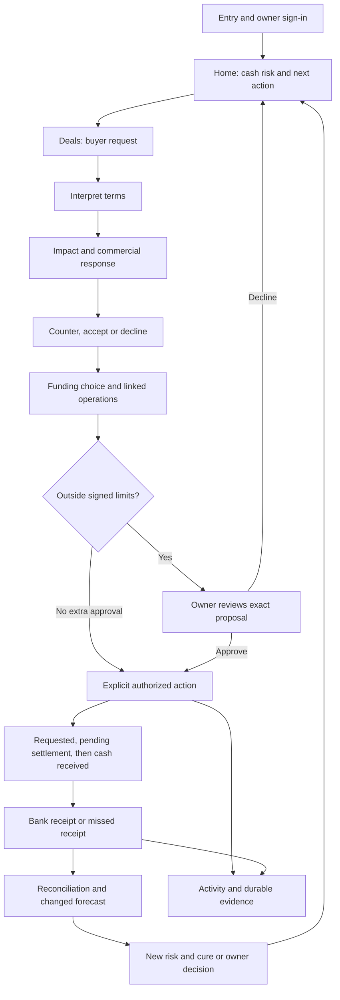

Method: dual-agent (A: `/root/independent_design`; B: `/root/technical_evidence`), plus principal live journey review.

# Independent FLOW end-to-end user-flow audit — 9 October 2026

## 1. EXECUTIVE VERDICT

**FLOW is a credible working-capital decision engine with an incomplete decision experience. It is not ready to be described as deployable owner software.** Its strongest screens explain cash risk and a priced response. Its weakest transitions misrepresent when a fact was true, whether an agreement exists, what an action does, and what remains unresolved after approval.

The original checkout's documented `pnpm dev` cold start returned HTTP 500 before Home loaded. A malformed touch CSS variant is the cause. I temporarily corrected that one rule to complete the audit, then restored the application source. Everything below distinguishes the original startup failure from the recovered runtime. This audit implements no UX redesign.

There are **28 actionable findings: 4 P0 financial/trust presentation issues, 14 P1 workflow failures, and 10 P2 friction issues; no ornamental P3 findings.** These are presentation and workflow severities under the user's system. This is not a claim that four unsafe transactions were executed. The backend protections tested here remained fail-closed.

The four P0s are:

- Current cash is presented as cash at a past reserve breach.
- Owners can approve commercial commitments without the essential terms being available in their review.
- A historical partial-payment receipt presents an expired discount deadline as “today.”
- The verdict screen says “Nothing is executed” after negotiation has executed funding.

**Do not start another visual redesign. Repair decision states and time semantics first.** Then put the recommendation, cost, arrival and authority together in the first useful viewport. Close one complete owner journey before adding another calculator.

Evidence and limits:

| Item | What was actually inspected |
| --- | --- |
| Initial baseline | `dev` at `e15e3eebec3b25d245eb67c7306f02d92b0e6bb2`, originally clean; the shared checkout advanced during the audit, so this was not a frozen-commit review |
| Primary runtime | Separate Next frontend :3015 and FastAPI :8015; memory store; `TERMSLEDGER_NO_DOTENV=1`; cached model; demo build with public synthetic credentials |
| Native browser | Fresh Safari audit tab; live Home, Deals, Cash, Receivables, Activity, Approvals, Ask FLOW, all fifteen Demo steps, missed and partial payment states |
| Automated browser | Disposable live web :3002 / API :8012; Chromium; 28 unique existing live checks and five phone checks passed |
| Responsive evidence | 44 full-page captures at 1440×900, 1366×768, 820×1180 and 412×915; normal and reduced motion; four screenshot walks passed |
| Backend/unit | 138 targeted backend checks and 30 web unit checks passed |
| Direct API probes | Partial receipt EXECUTED; replay DUPLICATE; foreign-currency offer abstained; real responses preserved |
| Detector | `impeccable detect --json apps/web`: zero findings. It missed the substantive issues below. |
| Not certified | Live model, real bank/lender connections, Postgres concurrency, deployed performance, full WCAG conformance, every Safari rendering behavior |

Earlier UX audit files were not used to form the findings. The mandated handover and product/design context were read as intent; those documents themselves contain summaries of prior work, so this was not a perfectly blind research study. Assessments A and B were isolated; detector results entered synthesis only after A finished. These are expert task walkthroughs and heuristic judgments, **not interviews or observed human five-second tests**.

**Concurrent-work boundary:** while the audit ran, the shared repository advanced through pilot-related work to `f7ba10c38bbc680944892c413ff737d8ec885d49`, and its active branch changed. The audit's captures and API responses establish the observed default golden-book workflows; they are not certification of that newer entire commit or its public-SME/pilot capabilities. The initial API ran without reload, while frontend/source reads came from the shared checkout. Newer pilot work is outside this report's tested scope. No concurrent history was reset or rewritten.

The evidence folder is [flow-ux-audit-2026-10-09](flow-ux-audit-2026-10-09/). The [technical assessment](flow-ux-audit-2026-10-09/technical-assessment.md), [responsive verification](flow-ux-audit-2026-10-09/responsive-verification.md), API responses, capture manifests and [demo timing](flow-ux-audit-2026-10-09/demo-timing.json) record the scope precisely.

## 2. WHAT FLOW CURRENTLY FEELS LIKE

Opening Home feels like a useful owner brief: “Your cash reserve becomes unsafe in 12 days,” ¥400k cash, a ¥300k reserve, and a ¥405k funding plan costing ¥3,113.93. This is specific, useful and more coherent than a generic dashboard.

Following the workflow feels like moving between an owner product, a financial laboratory and a command simulator. The owner has to reconstruct the difference between an acceptable offer, a negotiation outcome, a live commitment, a funding request, cash received and a historical execution. “Show” sometimes performs work; “Send this counter” runs a simulated negotiation; “Agreed” can be derived from ACCEPT; “Nothing is executed” survives actual funding.

The product is calm in supported healthy states. It is considerably less helpful when the first plan does not solve the whole problem. At that point a red conclusion can remain without a usable next decision.

| Persona | Current experience | Principal conflict |
| --- | --- | --- |
| SME owner | Strong cash diagnosis; scattered consequences and operational endings | Owner needs a decision, while the interface often presents module outputs |
| CFO / finance manager | Source, formulas and audit evidence are available | Exact terms and price history are sometimes less durable than hashes |
| Sales | Buyer asks and recommended counter are understandable | No selectable Option B action; permissible terms can appear agreed |
| AR / collections | Outstanding and overdue balances are readable | The report stops before a concrete chase or outcome handoff |
| First-time user | Product purpose and navigation are broadly recognizable | Token sign-in, owner/buyer roles and fixture commands require explanation |
| Judge | Engine breadth and guardrails are demonstrable | Fifteen technical steps compete with the one closed-loop business story |

## 3. WHAT FLOW SHOULD FEEL LIKE

An owner should receive one accountable business brief:

> Forecast cash becomes unsafe in 12 days because payroll is due before the customer pays. Borrow ¥150k today and finance ¥255k, arriving in three days. Estimated total cost: ¥3,113.93, assuming the stated repayment date. This is within your signed limits. Without action, cash reaches −¥105k in 30 days. With this plan, the forecast minimum is ¥300k. Customer receipts remain assumptions until the bank confirms them.

A deal should be one decision record:

> Foshan wants early payment at 1.2%, 60-day future terms and a 1% rebate. FLOW recommends a counter. The forward concessions cost ¥28,326.92 over the valuation window, above your ¥5,000 limit; the immediate discount is an additional cash cost. Offer 45-day terms, no rebate and a limited early-payment discount. See the complete economic cost, cash arrival and any linked borrowing before authorizing the action.

Every action should end with: **what ran, what did not, money received now, money still arriving, unresolved risk, and the durable decision record**. Evidence is one layer deeper; information essential to consent is on the review itself.

## 4. TOP 10 UX FAILURES

These ten are impact priorities, not the implementation sequence in section 28.

| Rank | Failure | Findings | Why it outranks polish |
| --- | --- | --- | --- |
| 1 | Time presentation changes financial meaning | F01, F03 | Current money and expired eligibility are falsely dated |
| 2 | Approval can hide the obligations being authorized | F02 | An owner cannot give informed consent to unseen commercial terms |
| 3 | Recommendation, agreement and execution states conflict | F04, F06 | Users cannot reliably determine whether something was agreed or money moved |
| 4 | Original cold start fails | F05 | No user journey begins successfully in the documented dev path |
| 5 | Counter action does not represent the displayed choice precisely | F07 | The user cannot control the advertised commercial response |
| 6 | Ask FLOW lacks selected-deal context | F08 | It asks users to restart work the page already completed |
| 7 | Demo viewing/replay and in-flight work are confused | F09, F10 | Revisiting or clicking quickly can reset the story |
| 8 | Fifteen-step Demo omits its promised late-payment loop | F11 | The product's differentiator is narrated instead of demonstrated |
| 9 | Approval endings omit residual risk and lose the quoted cost | F12–F14, F17 | An approved funding request is not necessarily a solved liquidity problem |
| 10 | Mobile and collections obscure or omit the next action | F15, F16 | Layout fits, but the owner still cannot act quickly |

Finding registry. Each finding includes the affected user, failure, misunderstanding, evidence, concrete change, expected impact, effort and confidence. **S** means a bounded component/copy/state change; **M** means several connected reads/views; **L** means a real capability or integration. Effort is a relative estimate, not a delivery promise.

### F01 — P0 — Home / Cash: current cash is backdated as a historical breach

**User:** owner, CFO. **Wrong:** after the clock advances to 34, `/home` returns current cash ¥44,986.20 and `first_breach_day: 0`; the hero shows “Cash at first breach ¥45k — 34 days ago.” Starting cash at day 0 was ¥400k. The engine's pre-as-of points repeat current cash; the presentation treats them as historical observations. **Misunderstanding:** the owner believes the business had ¥45k at an actual breach 34 days earlier and cannot distinguish today's position from history. **Evidence:** [home-missed-payment.json](flow-ux-audit-2026-10-09/home-missed-payment.json); `services/api/app/financial/trajectory.py:1030` and `:1080`; `services/api/app/api/home.py:696`, `:747`; `components/business/status-block.tsx:48`. The same fault recurred after a partial receipt, with ¥172k labeled 34 days ago. **Change:** use only points at or after `as_of_day` for forecast breach facts; if already below the reserve, say “Below reserve today.” A historical first breach needs actual historical evidence; do not infer it from the current projection. **Impact:** restores trustworthy time and cash meaning. **Effort:** M. **Confidence:** high, live UI + preserved API + source.

### F02 — P0 — Commercial approvals: essential terms are optional audit content

**User:** owner, finance manager. **Wrong:** exact obligations for ACCEPT_OFFER / RECORD_COMMITMENT sit inside “Audit details.” Approval buttons remain enabled when the ledger fails or the referenced commitment cannot be found. The missing-terms notice is also folded. **Misunderstanding:** approving an amount/headline appears to approve just that amount, while the operation can bind rebates, future price changes or payment terms the owner did not review. **Evidence:** `components/approval-card.tsx:23–33`, `:162–169`, `:211–215`; `app/approvals/page.tsx:18–19`, `:83`. **Change:** display counterparty, complete commercial terms, scope, duration, timing and economic effect before Approve. Disable Approve when required review terms are unavailable; show a recovery action beside it. IDs and hashes remain folded. **Impact:** informed consent and owner control. **Effort:** M. **Confidence:** high source-proven path; the exact failed-ledger browser injection was not run. Backend safeguards are not disproven.

### F03 — P0 — Receivables: an expired discount still appears available “today”

**User:** AR, owner, sales. **Wrong:** a partial receipt on day 2 records that another ¥128,600 may be settled early by day 2. On day 34, the receipt's `detail_when` still says “up to ¥128,600.00 more may be settled early by today.” On the same page, the promise summary correctly says the remaining amount falls back to the invoice's own due day. **Misunderstanding:** AR may offer or expect an early-payment discount that expired 32 days earlier. **Evidence:** compare [receipt-reconciliation-day2.json](flow-ux-audit-2026-10-09/receipt-reconciliation-day2.json) and [receipt-reconciliation-day34.json](flow-ux-audit-2026-10-09/receipt-reconciliation-day34.json), `receipts[0].detail_when`; live Receivables showed “32 days ago · … may be settled early by today.” `services/api/app/api/alerts.py:224`; `presentation.py:288`. The root cause is `relative_days`’s `by()` helper: every deadline at or before the read day becomes “by today,” including expired deadlines. **Change:** distinguish immutable event wording from current eligibility. Historical detail should say “At that time, the remaining amount could be paid by [fixed deadline].” Current state should say the discount deadline passed and show the actual outstanding balance. **Impact:** prevents incorrect collection terms and restores consistent eligibility. **Effort:** M. **Confidence:** high, live UI + two dated API snapshots.

### F04 — P0 — Verdict / negotiation: “Nothing is executed” survives executed funding

**User:** judge, owner, CFO. **Wrong:** after the cooperative negotiation, Ledger showed an active commitment and a ¥149,986.20 line draw. After the hard-line negotiation, the gap was funded. Both return to the REJECT verdict view, whose unconditional non-tier label still says “Nothing is executed.” **Misunderstanding:** the owner believes no money or commercial state changed. **Evidence:** native Demo steps 6–8; `app/verdict/page.tsx:127`; [receipt-negotiation.json](flow-ux-audit-2026-10-09/receipt-negotiation.json); [demo-completed-ledger.json](flow-ux-audit-2026-10-09/demo-completed-ledger.json). **Change:** label the evaluation narrowly: “Evaluation alone makes no changes.” After an action, show its actual execution summary and money timing above the historical verdict; never use the evaluation label as an overall transaction status. **Impact:** unambiguous execution and safer demo comprehension. **Effort:** S–M. **Confidence:** high, live UI + ledger/API + source.

### F05 — P1 — Entry: documented cold start returns HTTP 500

**User:** everyone. **Wrong:** `@custom-variant touch (@media (max-width: 63.999rem), (pointer: coarse));` generates dangling combinators for the coarse-pointer selectors. The dev compiler rejects CSS and Home never loads. Another production build tolerated/dropped the invalid branches; that does not rescue the documented dev workflow. **Evidence:** original `app/globals.css:5`; [original-startup-error.html](flow-ux-audit-2026-10-09/original-startup-error.html); recorded HTTP 500 and dev logs; B independently observed invalid-selector production warnings. **Change:** use an explicit custom-variant media block with `@slot`, then check the documented dev startup and both narrow/wide touch cases. **Impact:** makes any audit/demo/user journey possible and restores intended touch sizing. **Effort:** S. **Confidence:** high, original runtime reproduced. This was only a temporary audit workaround and was restored.

### F06 — P1 — Deals: acceptable, agreed and currently active are conflated

**User:** sales, owner. **Wrong:** `DealSteps` marks ACCEPT as responded/agreed without a negotiation commitment. The client also retains old negotiations after the clock expires a promise; day-34 Deals said “The agreement is on your books” and offered historical early-pay terms without a clear current lapse state. **Misunderstanding:** an acceptable offer is a completed agreement, or expired terms are still usable. **Evidence:** `components/deals/deal-steps.tsx:24–29`; `lib/use-current.ts:27`; day-34 native Deals compared with the expired commitment in Activity. **Change:** derive agreement state from the canonical commitment lifecycle, distinguish “Acceptable, awaiting agreement,” “Agreed,” “Fulfilled,” “Expired,” and “Revoked”; date historical evaluation snapshots. **Impact:** sales and finance share the same commercial reality. **Effort:** M. **Confidence:** high source; expired-state discrepancy observed live; ACCEPT-only branch source verified.

### F07 — P1 — Counter response: displayed choice and action contract differ

**User:** sales, owner. **Wrong:** “Send this counter” calls negotiation with only a cooperative buyer profile; it does not pass the displayed counter ID. Option B can be viewed but not chosen. Negotiation may also perform linked funding. The simulation note correctly admits the buyer reply is synthetic, but does not specify the action's full scope. **Misunderstanding:** the owner is sending the exact displayed proposal and doing only that. **Evidence:** `components/deals/response.tsx:197–201`, `:243`; `lib/types.ts:823–826`; negotiation's executed operations in preserved API responses. **Change:** for the existing capability, call the action “Run simulated negotiation,” state approved negotiation scope and linked funding before confirmation, and describe alternatives as comparisons. If a selectable-counter workflow is desired, bind the chosen counter and exact operations in its contract; do not fake selection with a label. **Impact:** honest commercial control and predictable money effects. **Effort:** S for honest scope; M/L for genuine selected-counter capability. **Confidence:** high, source + executed negotiation.

### F08 — P1 — Ask FLOW: page context is cosmetic, not a selected decision

**User:** first-time owner, CFO. **Wrong:** from evaluated Deals, the suggested “Why are we countering this?” returns “There is no verdict to explain yet. Evaluate an offer first.” On Activity, “What changed today?” returns a long “I can't do that” capabilities list. The request carries session/text but no selected offer or page decision. **Misunderstanding:** FLOW forgot its own analysis, or the page and chat describe separate businesses. **Evidence:** native owner chat; `lib/chat.ts:81–87`; `lib/chat-prompts.ts:127–130`. **Change:** bind read-only context to the selected decision using an explicit authenticated context reference; show what is being discussed. Add a deterministic changes read intent using existing events. Hide unsupported suggestions until the prerequisites exist. **Impact:** removes duplicate evaluation and makes chat useful. **Effort:** M. **Confidence:** high, two live failures + source.

### F09 — P1 — Demo: “Show” reruns mutations

**User:** judge, presenter. **Wrong:** completed steps labeled Show still call `goToStep`, which always runs the step. Showing Setup calls reset and clears deals, operations and approvals. **Misunderstanding:** the user is revisiting evidence, not erasing or repeating the scenario. **Evidence:** `app/demo/page.tsx:60–62`; `lib/demo-control.ts:21`; `lib/demo.ts:125–133`. **Change:** completed-step Show navigates to the saved result only. Explicit Replay / Restart controls state their effects separately. **Impact:** revisitable proof and a stable presentation. **Effort:** S–M. **Confidence:** high source; reset behavior was executed during the live walkthrough, but destructive completed-Show was not separately clicked.

### F10 — P1 — Demo: Scene 2 unlocks the stepper while work is still running

**User:** judge, presenter. **Wrong:** Scene 2 calls `clearDemo()` during `goToStep`; this restores `busy:false` and `step:-1` before its asynchronous work completes. Start demo briefly replaces Next. Fast clicking restarted the story, so 15 clicks ended at step 7. **Evidence:** `lib/demo-store.ts:129`; `lib/demo.ts` walk step; [demo-timing.json](flow-ux-audit-2026-10-09/demo-timing.json), earlier attempt. **Change:** clear scenario data without clearing the in-flight control state; keep the stepper locked until the transition commits its result. **Impact:** prevents accidental restart and race-driven story confusion. **Effort:** S. **Confidence:** high, live rapid-click reproduction + source.

### F11 — P1 — Judge Demo: closed-loop monitoring is narration outside the stepper

**User:** judge, presenter. **Wrong:** all 15 steps finish without a bank receipt, late-payment monitoring/cure/approval/settlement sequence. “After the deal” instructs moving the clock to day 34, but the clock correctly does not invent the day-2 receipt the narrative assumes. Following those instructions produced ¥45k and a ¥155,013.80 zero-floor cure, not the narrated ¥200k / ¥1,782.19 reserve-restoring cure. The existing live test creates the missing receipt via API. **Evidence:** `lib/demo.ts:125–209`; `app/demo/page.tsx:81–89`; `e2e/live.spec.ts:117` onward; native clock walkthrough; [home-missed-payment.json](flow-ux-audit-2026-10-09/home-missed-payment.json). **Change:** make a visibly labeled synthetic bank-event step part of the guided story, then advance, detect, queue, explicitly approve, settle and reconcile on that same state. Derive narration from current responses. Keep the clock itself incapable of assuming receipts. **Impact:** demonstrates FLOW's distinctive continuing agency in one coherent story. **Effort:** M. **Confidence:** high, complete live Demo + separate late-payment walkthrough.

### F12 — P1 — Zero-floor approval: consequence stops before the residual problem

**User:** owner. **Wrong:** the ¥155,013.80 approval explains cost, arrival and danger if declined, but has no after-state. `cure_after_words` explicitly returns None for a cure that does not restore the reserve. After approval, Home remains CRITICAL. **Misunderstanding:** approving the rescue restores the minimum reserve or resolves the problem. **Evidence:** native pending card; `services/api/app/api/home.py:351–355`; [home-after-decision.json](flow-ux-audit-2026-10-09/home-after-decision.json), CRITICAL and no next action. **Change:** state “Prevents negative cash; does not restore the ¥300k reserve,” with post-plan lowest cash, remaining reserve gap and a supported owner follow-up. **Impact:** informed approval of a partial rescue. **Effort:** M. **Confidence:** high, live before/after + source. Missing information is the finding; the card did not explicitly claim full safety.

### F13 — P1 — Approval history: quoted cost disappears after decision

**User:** CFO, owner. **Wrong:** before approval the card showed ¥1,381.32; after approval its Cost row disappeared. The queue computes presentation from current open alerts and plan costs, not a durable quoted decision summary. **Misunderstanding:** the transaction had no cost, or its original price cannot be recovered for review. **Evidence:** native same-card before/after; [approval-after-decision.json](flow-ux-audit-2026-10-09/approval-after-decision.json), `presentation.cost_display:null`; `api/operations.py:80`, `presentation.py:440–453`. **Change:** keep the quoted amount, charges, rate basis, assumed repayment, actual result and any later difference on the durable decision record. Do not derive historical price from today's remaining cure. **Impact:** auditable economics, not only auditable operation hashes. **Effort:** M. **Confidence:** high, live + preserved API.

### F14 — P1 — Refused approval: obsolete pending controls survive a terminal result

**User:** owner. **Wrong:** backend records a decision and may refuse its execution after revalidation. The adapter throws on REFUSED before rereading the queue; the page reloads only 404/409, not that refusal. Pending controls can be re-enabled until the next click fails as already decided. **Misunderstanding:** the approval still awaits a decision, or the first click failed before anything was recorded. **Evidence:** `lib/live/approvals.ts:67–70`; `app/approvals/page.tsx:31–40`; executed backend revocation/expiry revalidation checks. **Change:** reread the queue for every completed server decision; retain the refused execution outcome and explain that no money moved; distinguish authorization from execution. **Impact:** reliable recovery and no repeated decision guessing. **Effort:** S–M. **Confidence:** high source + backend execution; exact browser refusal-after-valid-owner branch not injected.

### F15 — P1 — Receivables: no usable collections handoff

**User:** AR, owner. **Wrong:** the invoice report and optional recommendation chips do not open a buyer thread, provide a collection draft, copy the invoice context or mark a review outcome. **Misunderstanding:** a “next action” chip is an action the product can perform. **Evidence:** `components/business/receivables-table.tsx:120`, `:174`, `:213–223`; `components/business/strategy.tsx:14–16`; live outstanding and overdue states. **Change:** provide one honest supported handoff, initially a copyable collection request or buyer-thread link with invoice, outstanding amount, due date and permitted terms. Add a review/outcome marker only with an explicit storage contract. **Impact:** converts a report into work saved. **Effort:** M; external messaging L and deferred. **Confidence:** high, source + live absence.

### F16 — P1 — Mobile: recommendation, cost and authority lose the first viewport

**User:** owner on phone, sales. **Wrong:** Home's large risk hero pushes cost/authority/Run below the first useful screen. Evaluated Deals first shows navigation, next-step band, Inbox and buyer asks; “Counter recommended” begins around y≈1,000 on a 915px viewport, and the priced response later. **Misunderstanding:** the owner has to explore a report before discovering the answer. **Evidence:** [phone Home](flow-ux-audit-2026-10-09/screenshots/phone/01-home-day0.png), [phone Deals](flow-ux-audit-2026-10-09/screenshots/phone/04-deals-evaluated.png); manifest: Home 1.8 screen heights; Deals 2.3; Cash 3.2. **Change:** put conclusion + priced response first on narrow screens, reduce Home's duplicate risk metrics to a compact summary, collapse Inbox after selection, retain original source and calculations below. **Impact:** shorter time to decision without hiding evidence. **Effort:** M. **Confidence:** high, four-viewport captures; no timed human study.

### F17 — P1 — Critical after-state: no explicit owner decision remains

**User:** owner. **Wrong:** after the zero-floor rescue is requested, Home is CRITICAL with no `next_action`, while a substantial reserve gap remains. The owner has a result but no next task. **Misunderstanding:** FLOW is finished, broken, or silently waiting for something. **Evidence:** [home-after-decision.json](flow-ux-audit-2026-10-09/home-after-decision.json); Home status and next-action rendering in `app/page.tsx`. **Change:** render an explicit residual-risk decision: amount uncovered, next deadline, what FLOW can and cannot execute, and a supported route to options/source evidence. Do not invent a feasible cure or waive reserve rules. NR1's wider product policy remains an owner decision. **Impact:** preserves control when automation reaches its limit. **Effort:** M. **Confidence:** high, API + live journey; exact next policy is intentionally undecided.

### F18 — P1 — Funding comparison: promised cost ranking is not the displayed order

**User:** CFO, owner. **Wrong:** the opening comparison says fully protecting plans are ranked by cost, but #2 is ¥5,040 and #3 is ¥3,938.81. Both buyer-dependent alternatives share the “fully protect” group despite conditional receipt agreement. The recommended #1 at ¥3,113.93 is still the cheapest shown; this is not evidence that the primary recommendation picked a more expensive plan. **Misunderstanding:** #2 is the next cheapest runnable alternative. **Evidence:** [desktop Cash](flow-ux-audit-2026-10-09/screenshots/desktop/05-cash-day0.png); `components/business/funding-options.tsx:137–147`; `dictionary.ts:1084`. **Change:** distinguish runnable now, conditional on buyer agreement and insufficient/unavailable; either sort the comparable alternatives on the stated basis or remove numbered cost rankings. Show each alternative's arrival, remaining gap and economic basis beside cost. **Impact:** valid comparisons and fewer misleading ordinal cues. **Effort:** M. **Confidence:** high, screenshot + source. It is a ranking-contract failure, not two conflicting values for the same amount.

### F19 — P2 — Evidence and scenarios switch the owner into the Demo shell

**User:** CFO, owner. **Wrong:** Cash's what-if/capex and Activity's evidence links reveal the large engine navigation. Direct `/demo` access can render the Demo shell while the mode radio still selects Business; pressing the already-selected Business option does not take the user Home. **Misunderstanding:** an owner tool is a test-only feature, or the mode switch is broken. **Evidence:** `lib/mode.ts:33–35`; live `/demo` with Business selected; Cash and Activity links. **Change:** keep contextual business detail/scenario/export routes inside the owner shell; reserve engine navigation for explicit Demo entry. Reflect the effective shell in the mode control and provide a clear “Back to Business” link. **Impact:** continuity and lower navigation load. **Effort:** M. **Confidence:** high, source + native route behavior.

### F20 — P2 — Business chat exposes role simulation and loses interrupted work

**User:** first-time or distracted owner. **Wrong:** owner/buyer role controls, Tier 1 text and eight general/ten contextual prompt buttons appear in Business. The draft and transcript/session pointer are not durably restored after refresh. **Misunderstanding:** the owner needs to simulate a buyer or memorize commands; an interrupted decision disappeared while its server effects may remain. **Evidence:** native chat; `chat-view.tsx:42`, `:148–177`; `lib/chat.ts:43–48`; `chat-prompts.ts:23–31`, `:127–130`. **Change:** default to the authenticated owner; show two to four state-appropriate read questions; move buyer simulation to Demo. Recover drafts, conversation context and pending decisions, or clearly direct to the durable activity/approval record after refresh. **Impact:** lower cognitive load and interruption resilience. **Effort:** M. **Confidence:** high source; initial prompt/role overload observed live; refresh recovery source verified.

### F21 — P2 — Freshness and supporting-read failure are invisible

**User:** CFO, returning owner. **Wrong:** current cash has no bank/input freshness or last successful read time. Supporting state failures can fall back to buyer IDs; optional strategy errors look like an absent feature. Multiple reads can therefore present partial context as a complete answer. **Misunderstanding:** the facts are current and complete when an input/read is stale or unavailable. **Evidence:** `lib/use-async.ts:40–42`; `app/receivables/page.tsx:21–34`; `app/cash/page.tsx:65–67`; Home's status block. **Change:** put last successful input/update time and a concise partial-data warning beside the conclusion. Distinguish unavailable recommendation from “none needed”; show a named recovery route. **Impact:** assessable trust without exposing state-version internals. **Effort:** M. **Confidence:** high source; no exhaustive fault injection of every supporting read.

### F22 — P2 — Reduced motion hides the visual busy indicator

**User:** sighted reduced-motion user. **Wrong:** the reduced-motion rule enables `.spinner-dots`, then a later equally specific base rule hides it again. Both spinner and dots disappear; `aria-busy` remains. **Misunderstanding:** a disabled button looks stalled rather than working. **Evidence:** original `app/globals.css:486–494`; compiled CSS in technical assessment; `components/icons.tsx:68–71`. **Change:** make the stationary indicator's reduced-motion rule win and/or show an explicit waiting label. **Impact:** perceivable feedback without motion. **Effort:** S. **Confidence:** high source + compiled cascade; no separate computed-style screenshot of the busy instant.

### F23 — P2 — Slow model/network work has no bounded recovery

**User:** owner. **Wrong:** fetch has no abort timeout, busy can remain until a response/rejection, and the composer blocks sending without a timed explanation or recovery. Immediate offline retry is tested; a hanging response is not. **Misunderstanding:** the system may have moved money, lost the instruction or frozen. **Evidence:** `lib/live/http.ts:67`; `lib/chat.ts:79`, `:114`; server timeout/retry configuration recorded in technical assessment. **Change:** show a slow-request state, distinguish model unavailability from unsupported intent, preserve request ID through recovery and reconcile operation status before any retry. **Impact:** safe, comprehensible failure recovery. **Effort:** M. **Confidence:** high source; real live-model timeout UX untested.

### F24 — P2 — Abstention is safe but not specific enough to resolve

**User:** buyer, sales. **Wrong:** an authenticated buyer's USD early-payment offer gets “Please clarify the terms: we cannot establish them from your message,” without naming the unsupported currency or the required correction. **Misunderstanding:** FLOW failed to read ordinary text; the buyer has no specific next answer. **Evidence:** [abstention-foreign-currency.json](flow-ux-audit-2026-10-09/abstention-foreign-currency.json); API probe. **Change:** identify the unresolved material field in plain language, ask one actionable clarification, say the offer was not agreed or executed. Do not weaken the fail-closed boundary. **Impact:** faster clarification and more credible restraint. **Effort:** S–M. **Confidence:** high API; exact buyer-pane rendering not manually tested.

### F25 — P2 — Partial receipt changes are summarized as no receipt and written as a formula sentence

**User:** AR, owner. **Wrong:** Home says the early payment “did not arrive” after part arrived; Receivables needs the reader to untangle ¥127,506.90 cash, ¥128,600 invoice portion, ¥257,200 agreed portion and the ¥420,000 original invoice in one sentence. The amount accounting remained consistent in the probe. **Misunderstanding:** nothing arrived, or the cash receipt equals the face amount settled. **Evidence:** [home-partial-payment.json](flow-ux-audit-2026-10-09/home-partial-payment.json); [receipt-reconciliation-day34.json](flow-ux-audit-2026-10-09/receipt-reconciliation-day34.json); native Receivables. **Change:** “Received ¥127,506.90. Cleared ¥128,600 of the invoice, including ¥1,093.10 discount. ¥291,400 remains overdue; the early-payment window has ended.” Keep the exact portion formula folded. **Impact:** understandable reconciliation and precise “what changed.” **Effort:** S–M. **Confidence:** high live + API.

### F26 — P2 — Set-aside message evidence link targets a nonexistent anchor

**User:** owner, judge. **Wrong:** Deals links to `/activity#refused`, while Activity uses `activity-refused`. Before the relevant security step, the fixture inbox can claim one message was set aside while Activity has no corresponding refusal record. **Misunderstanding:** the product cannot substantiate its safety claim. **Evidence:** `components/deals/inbox-list.tsx:174`; `app/activity/page.tsx:170`, `:174`; observed initial fixture inbox and empty Activity. **Change:** fix the anchor and bind the set-aside explanation to an actual recorded message/event; a supplied fixture example must be labeled as such. **Impact:** a checkable safety story. **Effort:** S for anchor; M for evidence association. **Confidence:** high source + opening states.

### F27 — P2 — Proof badge overstates what has been verified

**User:** owner, judge. **Wrong:** “Records verified” is prominent while the check is internal chain integrity; a customer promise, bank integration and business completeness are not independently verified by that badge. **Misunderstanding:** the books or bank facts were externally audited. **Evidence:** Activity captures; `app/activity/page.tsx` chain-valid badge; ADR-0004 and standing handover claim “internally checkable chain.” **Change:** use “Record chain checks passed,” explain the exact check in detail, and separate a bank-source confirmation from log integrity. **Impact:** defensible proof claims. **Effort:** S. **Confidence:** medium-high; misinterpretation is a heuristic risk, not observed human research.

### F28 — P2 — Chinese labels can surround English decision content

**User:** Chinese-speaking owner, finance manager. **Wrong:** the owner-facing queue's business presentation is generated with hardcoded `en`, and `getApprovals()` passes no language. A translated UI does not translate the decision the owner must authorize. Other server-generated detail sentences also do not uniformly take the selected language. **Misunderstanding:** labels promise a Chinese experience, but essential economics require English comprehension. **Evidence:** `services/api/app/api/operations.py:109–120`; `apps/web/lib/live/approvals.ts:34`; bilingual dictionary does not alter these server strings. **Change:** make language a consistent presentation-read parameter and preserve exactly the same economics/state in both languages. Keep raw source text in its original language. **Impact:** usable consent and consistent product language. **Effort:** M. **Confidence:** high source; a complete Chinese approval journey was not manually executed.

## 5. P0 TRUST / FINANCIAL PRESENTATION ISSUES

| ID | Risk | Evidence strength | Release acceptance |
| --- | --- | --- | --- |
| F01 | Current cash acquires a fictitious past date | Live UI + saved API + source | At day 34 and day 34 after a partial receipt, first forecast breach is today or future; no current amount is presented as day-0 actual history |
| F02 | Approval without reviewable exact terms | Source-proven enabled path | Essential terms visible; failed/missing term read blocks approval; hashes remain secondary |
| F03 | Expired discount presented as available today | Two dated API snapshots + live UI | Historical receipt cannot advertise current eligibility; overdue balance and actual deadline agree |
| F04 | User is told nothing ran after execution | Live Demo + operations | Every page's action state matches committed operations, with requested cash separated from settled cash |

These require targeted regression checks around **date advancement, partial settlement, unavailable terms and post-negotiation execution**. A general screenshot pass cannot close them.

No evidence here shows an executed receipt was counted twice or an advance was credited before its lead time. The duplicate receipt probe returned DUPLICATE; funding-in-transit checks passed. Keep those invariants.

The following were not promoted to P0 without sufficient evidence: conditional forecast copy (section 17), mislabeled secondary alternative ranking (F18), disappearing historical cost (F13), and partial-rescue omission (F12). Each is serious; their observed scope is specified rather than exaggerated.

## 6. END-TO-END USER FLOW MAP

Current transition audit:

| Transition / motivation | Primary action and predictability | Return and context | Defect / repetition |
| --- | --- | --- | --- |
| Entry → Home: see today's position | Token sign-in is clear mechanically; purpose of token is a deployability burden | Session auth survives tab navigation | Original startup fails; no real data onboarding or freshness |
| Home → identify problem: determine urgency | Strong headline, current cash, reserve and timing | No navigation needed; Why is one fold | No-action consequence and after-state are folded; F01 |
| Problem → buyer request: understand cause/opportunity | Deals navigation; fixture inbox message opens terms | Buyer selection retained | Separate read then check clicks; Inbox remains dominant |
| Request → interpretation: see what buyer wants | Clear discount / term / rebate sentences | Original source available | “Analysed” can precede financial evaluation; repetitive stage band |
| Interpretation → impact: determine whether to accept | Check against my limits | Result is cached | No freshness warning when books/clock move |
| Impact → recommendation: decide commercial response | Counter recommended is clear | Proof folds preserve source | Response below extra panels, especially phone |
| Recommendation → counter/accept/reject | Counter button clear in label | Outcome replaces counters | F06/F07; alternative cannot be chosen |
| Commercial response → funding | Backend may execute linked draw | Cash page reports resulting position | Linked funding scope not explicit before send; F04 |
| Funding → approval | Queue → confirm → approval-card link | Specific card anchor preserved | Repeated self-queue confirmation and multiple waiting references |
| Approval → action | Amount-specific Approve; Decline available | Decision remains on card | Essential commercial terms folded; quote/after-state missing in branches |
| Action → time passes | Business has no clock; Demo does | Clock advances stored books | Correctly no invented receipt; story assumes one nevertheless |
| Time → paid/unpaid | Bank operation or absence updates books | Receivables retains invoice / promise / receipt | No user-facing receipt-ingestion connector in Business |
| Receipt → reconciliation | Matched / flagged source available | Audit details retain bank reference | Partial receipt sentence overload; expired relative-time copy |
| Reconciliation → new risk | Home notices overdue/missed promises | Current books feed forecast | Partial payment described as no payment; current breach backdated |
| Risk → cure / owner response | A priced plan can be queued and approved | Arrival separated from cash | Residual reserve risk has no explicit next decision |
| Any result → Activity / evidence | Business event first, proof folded | Export available | Evidence opens Demo shell; “Records verified” overstates scope |

These transitions use existing modules. The proposed architecture should join their business states, not create another parallel optimizer.

User task results below use **minimum purposeful clicks after the starting page is loaded**, excluding sign-in, mode switching and scrolling. Source-inferred counts are marked. Navigation was done through visible controls or explicit route entry. `E` means executed native/automated runtime; `S` means source-supported. Reading times are **not measured human performance**. The short time ranges are heuristic reading budgets, not experimental results; only Demo has an actual measured mechanical duration.

| Task | Current route / clicks | Time / result | Confusion, wrong turn or missing answer |
| --- | --- | --- | --- |
| 1 Am I financially safe? | Home, 0 E | Heuristic 5–10s; conditional pass | Future forecast is not certainty; already-unsafe branch F01 |
| 2 When will cash be tight? | Home, 0 E | 5–10s; pass at opening | First breach and worst separate; past-data branch fails |
| 3 Why? | Home → Why, 1 E/S | 10–20s; partial | First screen lacks causal sentence; more details required |
| 4 What should I do? | Home, 0 E | 5–10s desktop; mobile scroll | No next task after partial rescue |
| 5 How much will it cost? | Home or Cash, 0 E | 5–10s; pass for plan | Exact assumptions folded; historical approved cost disappears |
| 6 When does money arrive? | Home, 0 E | 5–10s; pass for all-funds availability | One “in 3 days” obscures line's same-day leg until details/current funding |
| 7 If I do nothing? | Home → Details, 1 E/S | 10–20s; partial | Worst cash visible; full consequence hidden under generic Details |
| 8 What does buyer want? | Home → Deals → message, 2 E | 15–30s; pass | Inbox/request repetition before recommendation |
| 9 Should I accept? | Above + Check, 3 E | 20–40s; pass for rejection/counter | ACCEPT-to-Agreed stage misstates lifecycle |
| 10 What should I counter? | Evaluated Deals, 0 E | 10–20s + scrolling | Phone response is below first screen |
| 11 Why that counter? | Option A details / Why, 1–2 E/S | 15–30s; partial | Economic rationale and comparison distributed across folds |
| 12 Who owes me? | Home → Receivables, 1 E | 5–10s; pass | No concrete chase handoff |
| 13 Who is late? | Receivables, 0; Late filter 1 E | 5–10s; pass | No buyer contact/action context |
| 14 What needs approval? | Home badge/card → Approvals, 1 E | 10–20s; partial | Review insufficient in commercial/missing-term branches |
| 15 What changed today? | Home or Activity, 0–1 E | 10–20s; partial | Chat refused this ordinary question; causal cash bridge absent |
| 16 Show calculation | Evaluated Deals → calculation, 1 E/S | 20–60s | Formula/source visible; no single dated decision summary |
| 17 Original buyer wording | Evaluated Deals → Original message, 1 E/S | 5–10s; pass | Evidence is well disclosed |
| 18 Exactly what ran? | Activity, 1 from Home; Audit details +1 E | 10–30s; partial | Good business timeline; Verdict contradicts executed state |
| 19 Complete demo | Start + 14 Next, 15 E | **18.0s measured warm mechanical run**, no reading | All steps completed; closed-loop monitoring missing; fast-click attempt restarted |

No participant task-completion percentages or human timings have been invented.

## 7. HOME AUDIT

Opening ten-second owner test, expert heuristic:

| Question | Finding |
| --- | --- |
| Are we safe? | Opening ACTION NEEDED is clear; funding-ready healthy state is calm; safety remains forecast-dependent |
| Current cash? | ¥400k clearly labeled cash today; after requests, cash and incoming funds remain separate |
| Distance from reserve? | ¥300k minimum and ¥100k headroom are available, though “cash above minimum” would scan faster |
| Next serious risk? | Opening first breach in 12 days and worst −¥105k in 30 days are distinguished |
| Money on the way? | In-transit headline appears when applicable; keep it outside generic supporting details |
| Need my decision? | Pending badge/card is clear; no pending section at opening is sensible, but “No decisions need attention” is implicit |

Information hierarchy: conclusion at level 1; plan at level 2; cost/timing/authority at level 3; Why/Details contain levels 4–6. This mostly works. **After-state and the consequence of inaction are level 3, not mere evidence:** they should not both be hidden under generic Details in the decision moment. A minimal first-screen sentence can expose them without expanding the whole calculation.

Healthy states: “You're covered” and “Covered, but tight” correctly communicate zero forecast reserve buffer. Do not turn every covered state into green certainty. Explicitly say it is a forecast and identify payment assumptions.

Critical states: current money, first breach and worst point must remain distinct. F01 breaks this. F12/F17 show that avoiding negative cash is not restoring the reserve. Give the owner one residual-risk decision rather than another red metric.

Remove the separate future headroom caption when the worst-cash amount and reserve already make the relevant gap explicit. On phone, show current cash, reserve buffer and one future risk in a compact block; put the priced action directly next.

**Current:** large risk block → plan → receivables → changes → broad details. **Ideal:** status and cause → priced action and after-state → needs me → changes / next receipt → evidence.

## 8. DEALS AUDIT

**The business recommendation is materially better than the engine verdict screen. Keep “Counter recommended.”** It correctly translates a REJECT-with-counters into a commercial response. Parsed asks distinguish immediate discount, future terms and rebate. Source and formulas are progressively disclosed.

The normal evaluated deal is 1.7 desktop screen heights and 2.3 phone screen heights with folds closed. A phone owner first reads the page header, progress, next-step band, inbox, safety notice and buyer asks before reaching the recommendation. This does not meet the requested one-to-two-screen decision standard on phone.

Put one selected buyer/deal header above a compact “Buyer asks / Effect / Recommend / Cost / Action” workspace. Collapse Inbox once selected. Merge the recommendation and response cards; remove the separate jump band and passive stage links when they repeat the same transition. Keep the original text one layer deeper.

F06 is a lifecycle defect: ACCEPT means acceptable, not agreed. A historical negotiation and current ACTIVE/EXPIRED/FULFILLED state are different facts. Present both when needed and update the current state from books.

Counter audit:

| Counter | What user can understand now | What must improve |
| --- | --- | --- |
| A | 45-day terms remain, no rebate, up to ¥257,200 early at 0.85%; estimated supplier cost ¥3,027.77 | State cash received vs invoice face, deadline, linked line draw, repayment assumption and authorization scope together; allow an honest supported action |
| B | 55-day terms, 0.30% price adjustment, no rebate | It is comparison-only; no select/send control. Explain buyer receives ten extra days while supplier recovers funding economics through price |

Option B **does not** show a naked zero cost in the current implementation. Its business card presents approximate zero net economic cost beside gross financing value **¥16,217.95** and price offset **¥16,380.00**. The internal net is −¥162.05 but the verifier floors the headline; it must not be sold as a guaranteed gain. Keep this distinction. The label should also state the common valuation window and when price proceeds arrive: an offset is not cash today.

The ¥28,326.92 12-month forward-concession figure is **not the complete economic cost of the original offer**. Its label says “cost of concessions,” and the immediate discount is mentioned separately; avoid turning it into “total cost.” Show the immediate discount amount and forward economic cost on named lines when comparing total economics. Adding incompatible time bases without explanation would be misleading.

**Current:** choose message → compile → check → read risk → find response → simulate negotiation → inspect separate agreement/cash. **Ideal:** open deal → auto-present a dated analysis → review one priced response → explicit exact action scope → agreement/execution result with money timing.

## 9. CASH & FUNDING AUDIT

Strength: Cash reads the Home summary and draws its own supplied baseline/recommended series. Unavailable/insufficient rows are separated from viable rows, and the insufficient line-only plan names its uncovered gap. Keep this.

The original fully-funded plan appears consistently: ¥150k credit line + ¥255k invoice financing, ¥3,113.93 total charges, funds fully available in three days. Its component costs, ¥841.64 and ¥2,272.29, are supplied by the server. Current funding separates the same-day draw from the advance still arriving. This is an effective owner mental model.

F18 remains: #2 ¥5,040 and #3 ¥3,938.81 contradict “ranked by cost.” A future buyer agreement is a conditional alternative, not the same readiness as a runnable draw. Remove numerical ranks until comparison basis/order/readiness are explicit. Do not rank uncommitted government loans as cheap runnable solutions.

Each comparable plan should carry: named sources, complete charges, arrival schedule, any consent prerequisite, remaining reserve gap and repayment assumption. Users currently see much of that only in several disclosures. An alternative should not appear cheaper because it leaves financing, rebates or lead-time needs outside its price.

The chart belongs after the recommended decision but before an exhaustive source menu. Keep the menu folded. Cash is currently 2.3 desktop / 3.2 phone screen heights; more than forty money/time/rate occurrences make it the densest business screen.

**Current:** status → same Home plan → multiple option groups/folds → chart → what-if/capex doors. **Ideal:** cash position + active/incoming funds → one plan and after-state → a small comparable-options table → explanatory forecast → sources and calculations.

## 10. RECEIVABLES AUDIT

Who owes, how much, overdue balance and next payment are clear. At day 34 after the partial receipt, outstanding totals ¥1,131,400, including a ¥291,400 overdue original invoice. The receipt is ¥127,506.90 cash; ¥128,600 face was settled with a ¥1,093.10 discount. These are different quantities, correctly represented in the raw data.

F03 makes their eligibility timing inconsistent; F25 makes the sentence too hard to read. Replace the single nested monetary sentence with four named facts: received, face cleared, discount, remaining due. The exact arithmetic remains available.

Do not add giant “No payments received” or “No promise” cards. The current opening page is appropriately compact and suppresses absent sections. Keep that restraint.

Receivables currently answers “who owes?” and “who is late?” but not “what should AR actually do now?” F15 is the important missing task. Start with an honest buyer/invoice handoff using current data; do not add autonomous outbound collections merely to make a chip clickable.

The optional strategy ranking must disclose when it ranks by economic opportunity rather than lateness; the tour's claim that late invoices come first can otherwise be wrong. A failed strategy request should not silently read as no recommendation.

**Current:** balances → table/filter → promise/receipt details → leave the app to chase. **Ideal:** priority invoice and reason → buyer/invoice handoff → recorded or explicit external outcome → refreshed promise/receipt/risk.

## 11. ACTIVITY AUDIT

Activity now leads with useful business sentences: credit line received today; invoice advance still arriving; agreement recorded; owner approved. Hashes, tiers and raw executor text are folded. **This is a business timeline, not primarily a database log. Keep it.**

Its remaining problem is causality and lifecycle. “What changed” is mostly a list of operations, not a compact explanation of why the cash forecast changed or what is still unresolved. A current “Waiting for your approval” badge on a past queued event can compete with the later approved event; historical labels should read “Approval requested” and link to the current decision status.

F26 breaks the refusal explanation handoff. F27's proof scope needs honest wording. Do not put borrower files, hashes and counterparty IDs in the first sentence just because the system stores them.

**Current:** chronological operations + agreements + refusals + export. **Ideal:** business event → amount/timing/state change → related decision/invoice → current outcome → internal chain evidence.

## 12. APPROVAL / AUTHORITY AUDIT

Funding approvals are generally clear questions. The tested card named ¥155,013.80, ¥1,381.32 cost, funds in three days, the source/invoice, and why 32.5% yearly cost exceeded the owner's 15% autonomous limit. “Approve ¥155,013.80” is better than Go ahead. Decline explains that cash goes below zero in eight days.

The four failures are at the edge cases: F02 unseen commercial terms; F12 no after-state for a partial rescue; F13 disappearing historical cost; F14 obsolete pending controls after refused execution. A funding approval must also name repayment/date assumptions and residual risk. Approval is permission; settlement is a later event.

Authority copy “Within your signed limits. No additional approval required” is good. A manual request to run a within-limits plan is a trigger, not an additional Tier-2 approval; explain that distinction once. Avoid claiming fully automatic monitoring/action in a product whose main demonstrated flow requires the user to drive the clock and confirm steps.

The owner must not be offered a way to waive hard liquidity/eligibility rules. “No runnable plan” should ask for a supported decision, not invent authority.

**Current:** queue button → self-confirm → duplicate waiting references → approval card → result → cost may disappear / residual risk persists. **Ideal:** one complete proposal → explicit owner decision only if needed → clear terminal execution state → money timing + remaining task + durable quote.

## 13. ASK FLOW AUDIT

The promise is contextual conversation; the implementation's context is mostly page-specific prompt ordering. It does not identify the selected deal to the NL session. F08's live answer makes this visible immediately.

Useful current qualities: one conversation shared between panel/page, IME-safe Enter behavior, old confirmation buttons disabled, replay-safe request IDs and retry after sign-in. Preserve them.

Remove owner/buyer simulation, fixture identifiers and generic amendment/approval chips from Business. Show two to four questions that fit the current state: “Why this plan?”, “What arrives when?”, “What remains uncovered?”, “What changed?” An action suggestion should name a specific pending decision, not “approve it.”

A read question should return a short conclusion, supporting figure and source link. The observed unsupported reply instead lists fourteen capabilities. A safe failure should explain the missing context/field and offer one recovery.

Chat should help interpret the current decision; the clearest UI action should remain the explicit transaction review. A conversation must not become a second inconsistent authority model.

## 14. BUSINESS VS DEMO AUDIT

The owner shell's five destinations, relative day phrases and single Demo-data indicator are real improvements. It removes clock/stepper/security mechanics from normal business pages. Keep that separation.

Remaining leaks:

- Ask FLOW exposes speaking roles, Tier 1 and EX01 commands.
- Capex/what-if/evidence detail links force Demo navigation.
- Approvals expose token transport explanation in their business body.
- Approval audit terms can use day numbers; appropriate as audit detail, but essential business terms need business dates.
- Direct engine routes can show Business selected while rendering the Demo shell.
- “Send this counter” is a simulation and only the note admits that fact; the action should say it plainly.

Business mode also needs an actual dated data context. “In 13 days” is readable but not enough for finance users scheduling work in calendar systems. There is no validated business-calendar mapping in this audit; do not fabricate dates from the wall clock. Display a configured business as-of date and a calendar date alongside relative timing when real dated data is supplied.

Demo should expose simulation mechanics when they explain proof. It should not force every judge to learn the engine navigation before seeing the owner decision.

## 15. NAVIGATION / INFORMATION ARCHITECTURE AUDIT

Home, Deals, Cash, Receivables and Activity follow useful owner questions. They are substantially better than the fifteen engine destinations. Do not merge everything into a mega-dashboard simply to reduce nav count.

The main seam to repair is **decision detail**, not a wholesale destination change. Calculations, alternatives, original messages, approval, related execution and receipts should stay attached to a business decision/invoice. Opening one of them must preserve buyer, offer, state/date and return path.

Keep approvals as contextual attention plus a persistent account/history route; an absent pending badge should not make historical decisions undiscoverable. Keep Limits in account, but add a contextual limit link from a refusal/approval reason.

Merge `/funding` detail into Cash's evidence layer for business users; retain the engine route in Demo. Merge `/ledger` business content into Activity. Merge `/reconciliation` business content into invoice detail in Receivables. Integrate the business what-if/capex doors into the same owner shell. The capability can remain without a separate backend-shaped navigation item.

## 16. TERMINOLOGY / COPY AUDIT

| Term / phrase | Decision | Owner-facing wording or placement |
| --- | --- | --- |
| Minimum cash reserve | KEEP + EXPLAIN | Your minimum cash balance; signed threshold |
| Headroom | RENAME on headline | Cash above/below your minimum; “headroom” in finance detail |
| First breach | EXPLAIN | First day forecast cash falls below your minimum; “already below today” when applicable |
| Worst point | KEEP + EXPLAIN | Lowest forecast cash, with date and inaction/plan basis |
| Forward concession | HIDE IN DETAILS / RENAME | Future cost of the terms and prices you promise |
| Current books | RENAME | Today's recorded cash, invoices and commitments |
| Committed cure | RENAME | Available funding plan / proposed rescue |
| All-in APR | EXPLAIN | Annualized cost including fees; show actual currency cost first |
| Trajectory | RENAME | Cash forecast |
| Tier 1 / Tier 2 | HIDE IN DETAILS | Within your signed limits / Needs your approval |
| DSCR | EXPLAIN in finance detail | Debt-service coverage; label the modeled reserve-coverage reading, not bank-covenant compliance |
| Leverage | KEEP in finance detail | Debt divided by annual EBITDA; show definition |
| Obligation | RENAME on owner review | What you would agree to |
| Admissible | RENAME | Available within your signed limits / cannot run now |
| Committed plan | RENAME | Named sources: credit line + invoice financing |
| Conservative mode | EXPLAIN in detail | Forecast basis and the payments/funding counted; not a guarantee |
| Records verified | RENAME | Record chain checks passed; scope in detail |
| No verdict / unresolved scope | RENAME | I can't safely evaluate this yet; ask the specific missing question |
| Send this counter | RENAME until exact outbound capability exists | Run simulated negotiation; state linked operations |
| Go ahead | REPLACE for transaction controls | Run ¥X funding plan / Approve ¥X invoice financing |
| Future give-aways | RENAME | Cost of future commercial concessions; colloquial wording can trivialize contracts |
| Generate borrower file as Tier 2 | REMOVE misleading rule | Preparing the read-only file is not a queued financial operation |

Copy priorities: one conclusion → supporting number → explicit action. Split the partial receipt sentence (F25). Replace the unsupported fourteen-capability answer with one helpful recovery (F08/F24). Explain “cash exactly at reserve” as no forecast buffer; do not force mental subtraction.

Chinese presentation must cover generated decision content, not only label keys (F28). Original buyer text should remain original, with a clearly identified interpretation.

## 17. CHART / NUMERIC AUDIT

The main cash chart answers a useful question: **when does forecast cash become unsafe, and what does the recommended plan change?** Baseline/plan/reserve are distinguishable; negative cash is visible; first breach and lowest point are marked; a table supports precise reading. No decorative sparkline is needed.

Financial truth checks:

| Quantity | Observed result | Judgment |
| --- | --- | --- |
| Opening cash / reserve / buffer | ¥400k / ¥300k / ¥100k | Consistent; keep explicit units and basis |
| Opening first breach / worst | Day 12 ¥60k / day 30 −¥105k | Distinct and consistent on opening books |
| Recommended funding | ¥150k + ¥255k; total ¥405k | Consistent across Home/Cash and tested live adapters |
| Cost | ¥841.64 + ¥2,272.29 = ¥3,113.93 | Complete named plan charges; repayment assumption matters |
| Pending funding vs cash | ¥255k arriving in three days is not cash now | Correct, verified |
| Original forward concessions | ¥24,326.92 terms + ¥4,000 rebate = ¥28,326.92 | Named forward value; not total offer cost including immediate discount |
| Counter A | ¥257,200 face, 0.85%, supplier cost ¥3,027.77 | Face, cash receipt, discount and other funding must remain distinct |
| Counter B | ¥16,217.95 gross, ¥16,380 offset; approximate zero headline | Good net/gross separation; valuation window and proceeds timing should be explicit |
| Past first breach | Current ¥45k labeled 34 days ago | **P0 F01** |
| Partial receipt deadline | “by today” on day 2 and again day 34 | **P0 F03** |
| Approved quote | ¥1,381.32 disappears after decision | P1 F13 |
| #2 / #3 funding order | ¥5,040 before ¥3,938.81 while promising cost ranking | P1 F18 |

Chart assumption problem: the subtitle says **“confirmed receipts and committed funding only,”** but the forecast contains scheduled customer payments at their due dates, including the ¥420k expected receipt. These are not observed bank receipts. On actual agreed books, future buyer performance also affects the projection. Replace that phrase with “expected invoice payments and committed funding; overdue payments excluded,” and show the precise basis. This is an important P2 assumption-copy issue within F21; the chart is clearly a forecast, so the audit does not claim those future amounts were shown as current cash.

The timeline should label payroll, debt service, customer receipts, funding arrivals and repayment as appropriate. Opening desktop captures show an “Operating bill −¥100k” label positioned at a day with multiple events and a net positive cash jump: that label alone does not explain the jump. Prefer the day's grouped net movement plus important components in the tooltip or event list. Largest-event suppression must not make an outflow look like the cause of a rising line.

On phone, event text is intentionally reduced. The first breach and lowest point remain; use a small adjacent event list for the next three important movements, not more labels inside a narrow chart. No serious overflow was established in the tested widths. This is not an exhaustive cross-browser chart accessibility certification.

## 18. RESPONSIVE / ACCESSIBILITY AUDIT

Responsive evidence: four viewport classes, 44 current captures. Phone navigation, target-size checks, account dismissal/focus return, page titles, and a long chat reply fit the tested 412×915 viewport under the temporary CSS correction. **The previously noted phone chat overflow was not reproduced in these checks.** Do not keep reporting it as confirmed current debt without reproduction.

The problem is prioritization, not simply geometry: Home and Deals require scrolling before the decision's cost/authority/action. Desktop cards are stacked with much the same hierarchy on phone. F16 asks for a task-specific order and density.

Accessibility strengths: semantic sections/headings, skip link, native buttons/radios/dialogs, visible focus system, status words alongside color, error `role=alert`, loading `role=status`, chart table, IME-safe Enter, focus return on modal/account close.

Confirmed concern: reduced-motion busy dots disappear (F22). Original CSS also breaks intended coarse-pointer styling and dev startup (F05); narrow-phone passes on the corrected runtime do not validate the original wide-touch branch.

The project's 44px touch target is a design floor. WCAG 2.2 AA target-size minimum is generally 24×24 CSS pixels with defined exceptions/spacing alternatives; **below 44px is not by itself an AA failure**. See [W3C target-size guidance](https://www.w3.org/WAI/WCAG22/Understanding/target-size-minimum.html). Status updates should also be programmatically perceivable without requiring focus movement; see [W3C status-message guidance](https://www.w3.org/WAI/WCAG22/Understanding/status-messages.html).

Not completed: full contrast sweep, screen-reader session, 200%/400% zoom/reflow, wide coarse-pointer hit-box measurement, real device testing, complete keyboard traversal of all expanded financial tables. Targeted color tests were blocked by the mock build environment. No WCAG certification is claimed.

Native Safari screenshots intermittently omitted animated cards while their accessibility tree exposed them. Settled Chromium captures in normal/reduced motion rendered them correctly. **The Safari observation remains unconfirmed; it is not counted as an application defect or explained as a proven compositor problem.**

## 19. DEMO FLOW AUDIT

All fifteen guarded steps completed in **17.997 seconds / 15 step clicks** with cached API and warmed routes. Reading, narration, entry, reset and approval decisions are excluded. This proves mechanical traversal, not judge comprehension in eighteen seconds. An earlier unguarded rapid-click attempt took 20.848 seconds / 15 clicks but ended at step 7 because Scene 2 reset the busy/progress state (F10).

Current story order: mandate → compile → trajectory → funding → verifier verdict → simulated negotiation → ledger → reset/hard-line negotiation → funding → ledger → reworded offer → capex → queued approval/borrower file → security → evidence.

This is a tour of modules. It spends several screens establishing a rejected offer, resets the business to demonstrate another buyer personality, and changes to capex before demonstrating the monitoring loop. The mandatory owner decision is queued but Next proceeds to Security without the presenter deciding it. The “After the deal” block describes the actual differentiator in prose rather than making it a guided state transition.

Proposed 3–5 minute judge flow, six scenes:

| Scene | What judge sees | Purpose |
| --- | --- | --- |
| 1 Buyer asks | Original buyer request beside plain interpreted terms | The financing pressure is hidden in commercial language |
| 2 Decision | Forward cost, cash impact, recommended counter and exact scope | FLOW makes the economics understandable |
| 3 Agreement + action | Simulated buyer response, live commitment, cash now vs arriving | The decision changes actual stored books |
| 4 Reality diverges | Explicit synthetic bank receipt and later missing payment | Clock never invents receipts; promise and reality differ |
| 5 Owner control | Priced cure above autonomous rate ceiling; explicit owner review; settlement | Safe autonomy is visible at the decision moment |
| 6 Outcome + proof | Updated cash/residual risk, reconciled receipt, linked activity and internally checkable export | Close the story and demonstrate accountability |

Capex, rewording invariance, exhaustive funding menu and security probes become optional judge questions. Security remains available; a compact refusal linked to its evidence can explain safety without another giant screen. Do not delete engine capabilities to shorten narration; delete their compulsory place in the core story.

## 20. REAL BUSINESS FLOW AUDIT

Morning owner: Home → one urgent decision → clear result → what FLOW is waiting for. Current Home handles supported cases; residual-risk and freshness are gaps.

Finance manager: verify changes in cash against the last known position, inspect the cost/repayment assumptions, compare feasible alternatives, approve the exact terms, and reconcile actual receipts. Current product supplies much of the data but lacks a cash-change bridge and stable approved price summary.

Sales: select buyer → safe terms envelope or current request → review allowed proposal → send through a genuine channel or export it → know whether agreement is confirmed. Existing optional envelope capability is a promising detail. Business's synthetic send cannot be presented as a deployable outbound channel.

AR: highest-impact late invoice → contact context/draft → expected promise → actual receipt → remaining balance and next chase. The table stops before the handoff.

Deployment gaps are not minor UX fixes: no demonstrated real bank feed, outbound buyer channel, real-company data onboarding or authenticated multi-user role experience; token sign-in is not a normal finance-manager account flow; the clock is simulated. Label those honestly. Avoid claiming Business mode is deployable merely because its chrome omits Demo controls.

These gaps do not justify building everything before the hackathon. The high-value immediate work is making the existing synthetic owner loop complete and truthful, with a clearly defined product boundary.

## 21. DUPLICATION / COGNITIVE LOAD AUDIT

Closed-state main-content manual counts, not DOM measurements. Header/nav/account/Ask trigger excluded. Fact tiles counted separately from major panels; repeated numbers count again. M/T/R = money / numeric time or duration / percent rate occurrences; chart axes included. S/W = status / section-wayfinding colors, excluding neutral/brand/chart colors. `≈` marks judgment/occlusion uncertainty.

| Screen/state | Panels + tiles | Badges | Numbers M/T/R | Actions | Expanders | Colors S/W | Headings | Body blocks | Charts |
| --- | --- | --- | --- | --- | --- | --- | --- | --- | --- |
| Home opening | 4 + 6 | 1 | 16 / 5 / 0 | 3 | 3 | 2 / 0 | 3 | ≈4–5 | 0 |
| Deals evaluated | 8 + 3 | 2 | 8 / 9 / 7 | 9 | 6 | 2 / 1 | 6 | ≈10–12 | 0 |
| Cash opening | 6 + 7 | 6 | ≈30 / 16 / 0 | 6 | 9 | 3 / 1 | 9 | ≈9 | 1 |
| Receivables opening | 1 + 3 | 1 | 4 / 2 / 0 | 0 | 1 | 0 / 1 | 2 | ≈2 | 0 |
| Activity empty | 1 + 0 | 0 | 0 / 0 / 0 | 1 | 0 | 0 / 1 | 2 | ≈6 | 0 |
| Activity funded | 1 + 0 | 3 | 2 / 1 / 0 | 1 | 2 | 1 / 1 | 2 | ≈8 | 0 |

Chat has eight general or ten contextual prompt choices, plus role selection, new-conversation control, composer and any transaction controls. This is above the useful choice budget at the first decision. Demo has fifteen step actions, five scene jumps, engine navigation, clock/reset/scenario controls and side doors. No screenshot-based cardinality is claimed for all approval/chat error states.

Duplication decisions:

| Repeated fact | Primary location | Secondary reference | Remove / fold elsewhere |
| --- | --- | --- | --- |
| Current cash / reserve / next breach | Home owner brief | Cash compact position strip | Repeated long conclusion across several cards |
| Funding plan economics | One canonical decision record | Home preview; Cash comparison | Independent re-created transaction summaries |
| Buyer wording / interpreted terms | Selected deal | One-line inbox preview | Full selected message taking first-screen space |
| Recommendation / next action | Deal decision + response workspace | Inbox status | Repetitive stage/jump/recommendation bands |
| Pending approval | One contextual decision card | Header attention count; historical request event | Several identical “waiting” blocks/links on Home |
| Accepted terms | Durable agreement/decision detail | Deals status; related Activity event | Another full commitments table on every page |
| Receipt amount / remaining invoice | Invoice detail | Home change sentence; Activity event | Long promise/receipt monetary sentences repeated verbatim |
| Hash/operation/state identifiers | Audit detail / export | Record-check status with explained scope | Headline transaction language |
| Monthly ratios | Cash finance detail | Related approval reason only when decisive | Engine panels on Home by default |

This is progressive disclosure with ownership of facts, not hiding evidence. Do not fold cost, timing, exact authorized terms or the fact that a rescue leaves risk unresolved.

## 22. PRODUCT OPPORTUNITIES DISCOVERED

These are opportunities, separate from the fixes above. Prioritize existing state reuse.

| Opportunity | Existing data reused | Business value | Priority / effort |
| --- | --- | --- | --- |
| “What changed since my last visit?” cash bridge | Operation events, receipts, posted flows, old/new forecast | CFO can explain the cash movement and identify causes | Highest after correctness; M |
| “What is FLOW waiting for?” | Pending approvals, unsettled lots, commitments, overdue invoices, unavailable facilities | Owner sees blockers and next responsible party | High; M |
| Priority collections handoff | Outstanding invoices, due dates, existing collections-worth read | AR spends time on the cash-critical buyer, with a draft/context | High; M; external sending deferred |
| “What can I safely offer this buyer?” | Existing optional terms envelope and price curve | Sales avoids negotiation that consumes liquidity unknowingly | High reuse; M; validate permitted-term meaning |
| Residual-risk explanation | Plan after-state, reserve gap, readiness flags | Partial rescues remain controlled rather than falsely calming | High; M; new cure policy requires owner decision |
| Liquidity capacity consumed by a deal | Counter projections, available facilities, concession budget | Owner sees opportunity cost, not merely a pass/fail verdict | Later; M/L, needs defined comparison basis |
| Promise reliability view | Dated promise/receipt history | Finance can review recurrence of delays and forecast assumptions | Later; M; do not infer a credit score from a tiny demo sample |

Do not add a “liquidity score,” AI confidence gauge or generalized credit recommendation to compensate for unclear facts. The existing exact state has more value than another opaque metric.

## 23. SCREENS / COMPONENTS TO REMOVE

Remove from the **default owner decision experience**:

- The expanded selected Inbox thread once the selected deal is understood; leave a compact buyer/request header and one return to Inbox.
- The separate deal jump band and four passive stage links when a clear response/action already provides the next step.
- Numerical funding ranks whose ordering/readiness contract is not true.
- Owner/buyer role simulation and fixture prompt chips from Business Ask FLOW.
- Duplicate waiting-for-approval blocks; keep one decision card and the header attention indicator.
- “Nothing is executed” as a global verdict-page state after action.
- Token transport/security implementation paragraphs from the business approval body.
- Always-visible empty refusal/commitment machinery when its absence contributes no decision value.
- Capex and rewording invariance as compulsory judge story steps.

Do not delete original buyer sources, economic calculations, authority checks or audit evidence. Move them to appropriate detail.

## 24. SCREENS / COMPONENTS TO MERGE

Merge recommendation + counter response + action scope into one deal workspace. Merge funding quote + approval review + execution outcome as different states of the **same durable decision**, rather than independent cards that recompute history.

Merge business Funding detail into Cash, business Ledger into Activity, and business Reconciliation into invoice detail in Receivables. Keep the engine pages in Demo for technical inspection. Keep what-if/equipment analysis inside the owner shell with a return to the initiating decision.

Merge “What changed” and the relevant updated cash/risk into a small causal summary linked to full Activity. Do not merge the entire Activity timeline into Home.

## 25. SCREENS / COMPONENTS TO KEEP

| Keep | Why |
| --- | --- |
| Home's conclusion-first owner brief | It answers the core cash question quickly in supported states |
| Five business destinations | They fit useful user questions; the problem is handoff, not their existence |
| Commercial recommendation distinct from engine verdict | “Counter recommended” expresses what the owner should do |
| First breach versus worst point | These are different financial facts; preserve them with corrected date basis |
| Gross funding cost / offset / net economic result | It avoids presenting a price compensation as free funding |
| Runnable versus insufficient/unavailable funding separation | It prevents a cheap inadequate source from looking equivalent to a solution |
| Actual cash separate from in-transit funding | This is fundamental to reliable money timing |
| Business Activity with inline audit detail | It gives understandable results with proof available |
| Native dialogs, focus return, skip link, chart table | They support keyboard and accessible task use |
| Bound operations, stale-alert rejection, replay-safe retry | Safety is visible and testable; do not loosen it for smoother demos |
| No invented receipt from advancing the clock | Missing customer money must remain detectable |
| No large empty sections for absent promises/receipts | Healthy/simple businesses should remain visually quiet |

## 26. PROPOSED FINAL INFORMATION ARCHITECTURE

Business shell:

| Destination | Primary owner question | Details one layer deeper |
| --- | --- | --- |
| Home | Are we okay, what needs me, what changed? | Source freshness, causal drivers, limits, forecast basis |
| Deals | What is the buyer asking, what can we agree to? | Original text, interpreted terms, priced alternatives, full calculation, agreement history |
| Cash | What money is available/arriving, what plan solves the gap? | Comparable plans, repayment basis, forecast events, facilities and debt readings |
| Receivables | Who owes, who is late, what is the next collection step? | Invoice, promise, actual receipts, discount/portion reconciliation, bank references |
| Activity | What actually changed and why? | Related decision, authorization, operation result, internal chain/export |

Approvals are a contextual queue plus persistent decision history. Limits/data context/account settings stay reachable from account and from relevant reasons. A decision detail drawer/page preserves buyer, invoice, quote, state/date and return destination.

Demo shell: one guided six-scene business story, explicit synthetic event controls, reset/replay separated from view, optional engine/evidence navigation. Mode indicators reflect the actual shell.

## 27. IDEAL USER FLOWS

| Flow | Current experience | Ideal experience |
| --- | --- | --- |
| Morning cash check | Home metrics and plan; assumptions/consequence folded; partial rescue ends red | Conclusion + cause + priced action + after-state + explicit residual decision |
| Buyer deal | Inbox → read → check → separate risk → response → simulator | Select deal → dated analysis → one commercial response → exact scope → clear agreement and linked funding |
| Funding | Recommendation duplicated; numbered conditional alternatives; evidence fragments | One canonical quote → runnable/conditional comparison → timing/repayment → authorize → cash now/pending |
| Owner approval | Queue → confirm → card; terms optional; history loses cost | Exact review terms and economics → one decision → authorization/execution outcome → durable quote and next task |
| Collection | Overdue row → generic detail → external work | Prioritized invoice → context/draft handoff → promise/outcome → actual receipt → outstanding balance and risk |
| Payment mismatch | Dense amount sentence, stale historical deadline, partial summary omission | Received/expected/cleared/discount/remaining named apart → specific discrepancy → permitted response |
| Ask FLOW | Prompt ordering follows route; NL session doesn't know selected deal | Explicit read context → short answer/source → relevant next question or exact reviewed action |
| Judge Demo | Fifteen module steps, reset mid-story, monitoring as prose | One buyer decision → changed books → explicit receipt/late event → owner-controlled cure → settled result/proof |

Every flow must preserve a predictable return and show whether its evidence is current or historical.

## 28. TOP 10 CHANGES IN IMPLEMENTATION ORDER

H/M/L indicate relative user/trust/business/demo impact. Risk is implementation regression risk, not current defect severity. The ordering accounts for startup prerequisites, financial meaning and dependent workflows.

| Order | Concrete change | IDs | User | Trust | Business | Demo | Effort | Risk |
| --- | --- | --- | --- | --- | --- | --- | --- | --- |
| 1 | Ship valid touch variant and verify documented startup | F05 | H | M | H | H | S | L |
| 2 | Correct current-vs-historical date and expired-payment presentation | F01, F03 | H | H | H | H | M | M |
| 3 | Complete approval review: required terms, residual outcome, durable quote | F02, F12, F13 | H | H | H | H | M | M |
| 4 | Derive agreement/execution/refusal states from committed results | F04, F06, F14 | H | H | H | H | M | M |
| 5 | Make counter action scope exact and honest; expose alternatives appropriately | F07 | H | H | H | H | S→M | M |
| 6 | Bind Ask FLOW to the current decision and support changes/why reads | F08, F20 | H | H | H | H | M | M |
| 7 | Separate Demo Show/Replay/Reset and keep in-flight transitions locked | F09, F10 | M | H | M | H | S–M | L–M |
| 8 | Integrate the explicit bank-event / late-payment / approval / settlement story | F11 | H | H | H | H | M | M |
| 9 | Put the priced response first on phone and collapse selected Inbox | F16 | H | M | H | H | M | L–M |
| 10 | Close residual-risk and collections handoffs using supported existing data | F15, F17, F25 | H | H | H | M | M | M |

F18 ranking, F21 freshness, F22 loading, F23 recovery and F28 generated-language parity are required follow-ups, not optional decoration. They should be included when touching their respective decision contracts; do not expand every task into a broad redesign.

Acceptance is about behavior, not test count. A change is done when an owner can say what will be authorized, total economic scope, when cash lands, what remains risky and what actually happened, and the statement matches the stored result after the clock/state changes.

## 29. QUICK WINS

- Correct the touch variant (F05), then remove the audit-only workaround from the report's status once a real fix is shipped.
- Replace global “Nothing is executed” with narrowly scoped evaluation language and actual action result (F04).
- Fix the refused anchor (F26).
- Make completed Demo Show navigate without rerunning and preserve busy state through data clears (F09/F10).
- Make reduced-motion dots visible (F22).
- Remove EX01 / amendment / “approve it” prompt chips from default owner chat (F20).
- Replace “Records verified” with the actual internal check (F27).
- Split partial-receipt copy into named facts (F25).
- Remove misleading numerical cost ranks pending a correctly ordered/readiness-labeled comparison (F18).

These are useful but insufficient without approval and time-state corrections.

## 30. DEEPER REDESIGNS

The main redesign is a **durable decision record**: the quoted proposal, exact terms, cost basis, data/state/date, authority needed, approved/rejected decision, executed/refused operations, settlement state and remaining task all belong to one record. Pages show different views of it rather than reconstructing its past economics from current alerts.

The second is a business decision workspace. Selected buyer requests, cash plans and invoice collection work share the pattern conclusion → recommended response → cost/timing/consequence → reasoning → calculation → audit. That pattern can reuse existing components; it does not require a new financial engine.

The third is the guided demo as a real state journey with explicit synthetic events. Completion must prove the late-payment loop and owner control, not only that fifteen buttons are clickable.

Freeze financial policy changes while improving those interfaces. Preserve ADR-0006 time/receipt rules, ADR-0007 early-pay exclusion, ADR-0009 invoice terms and ADR-0010 funding settlement. No recommendation here authorizes the frontend to compute or silently alter money.

## 31. WHAT NOT TO BUILD

Do not build a new dashboard, another approval surface, a second funding optimizer, a generalized scenario lab, a confidence meter, automatic collections, a credit score, more engine navigation, a real lender connector or capex expansion before the core decision contracts are repaired.

Do not hide exact obligations in the name of simplicity. Do not manufacture calendar dates, pilot users, bank confirmations or external audit assurance. Do not auto-approve the owner's step to make the demo shorter. Do not cause the clock to invent customer receipts. Do not remove backend fail-closed checks to improve apparent task completion.

Do not treat the zero-finding design detector or passing existing tests as a substitute for semantic user-flow checks. The new P0s occur across time and transaction states, which the current happy-path assertions do not adequately cover.

## 32. FINAL UX SCORECARD

Scores are expert judgments, 1–10, for the **temporarily recovered runtime**. Higher cognitive-load score means lower unnecessary load. The original cold-start experience cannot earn these scores because it did not load.

| Surface | Clarity | Cognitive load | Actionability | Trust | Financial comprehension | Consistency | Efficiency |
| --- | --- | --- | --- | --- | --- | --- | --- |
| Home | 8 | 7 | 7 | 5 | 7 | 6 | 7 |
| Deals | 7 | 6 | 5 | 5 | 7 | 5 | 5 |
| Cash | 7 | 5 | 7 | 6 | 7 | 6 | 6 |
| Receivables | 7 | 7 | 3 | 5 | 5 | 5 | 4 |
| Activity | 8 | 8 | 6 | 6 | 6 | 6 | 7 |
| Approvals | 7 | 6 | 6 | 4 | 5 | 4 | 5 |
| Ask FLOW | 4 | 4 | 4 | 5 | 4 | 3 | 3 |
| Business/Demo separation | 6 | 5 | 5 | 6 | 5 | 4 | 5 |
| Mobile | 6 | 5 | 5 | 6 | 6 | 6 | 5 |
| Demo flow | 5 | 3 | 5 | 4 | 6 | 4 | 4 |

Why the low scores: approval trust suffers from hidden unavailable terms and lost prices; Receivables actionability stops at a report; Ask FLOW fails ordinary contextual questions; the Demo lacks its promised closed-loop story and confuses view/replay/state. Mobile efficiency suffers from decision placement, despite tested geometry fitting.

Five-second page test, heuristic verdict:

| Page | What page is about? | What matters / problem? | Clear next action? | Verdict |
| --- | --- | --- | --- | --- |
| Home opening | Yes | Yes | Desktop yes; phone incomplete; critical-residual branch no | PARTIAL |
| Deals selected/evaluated | Yes | Recommendation is below Inbox/request | Response exists but delayed / imprecise scope | FAIL on phone; PARTIAL desktop |
| Cash opening | Yes | Yes | Run plan clear; comparison assumptions weaker | PARTIAL |
| Receivables | Yes | Who is late clear | No concrete chase handoff | FAIL for collections task |
| Activity | Yes | Business events clear | Appropriate evidence/detail action | PASS for timeline task |
| Funding approval | Yes | Amount/cost/why generally clear | Yes, but edge cases omit terms/after-state | FAIL in commercial/missing-term/partial-rescue branches |
| Ask FLOW | Role and commands compete | No selected-decision context | Many suggestions, including unsupported ones | FAIL |
| Demo story | Broad purpose yes | Fifteen module steps compete | Next is visible but unsafe during reset transition | FAIL for cold judge comprehension |

Independent A Nielsen table, source-led and checked against principal runtime findings:

| Heuristic | /4 | Main reason |
| --- | --- | --- |
| Visibility of system status | 2 | Agreement/execution/current eligibility can conflict |
| Match with real world | 3 | Good business Home; engine/role vocabulary leaks |
| User control and freedom | 2 | Exact counter selection and interrupted context weak |
| Consistency and standards | 2 | View/run labels, shells and decision history diverge |
| Error prevention | 2 | Good backend binding; essential approval terms optional |
| Recognition over recall | 2 | Context handoffs require reconstructing prior work |
| Flexibility and efficiency | 1 | Collections and selected-counter workflow incomplete |
| Aesthetic/minimalist design | 3 | Owner hierarchy mostly restrained; chat/Demo overloaded |
| Error recovery | 3 | Retry/conflict paths thoughtful; refusal/hung gaps remain |
| Help/documentation | 2 | Tours exist but cannot substitute for coherent task states |
| **Total** | **22/40** | Significant interaction work needed |

Technical B: accessibility 3/4, performance 2/4, responsive 3/4, theming 3/4, integrity 2/4 = **13/20**, conditional on recovered runtime. These are not certification scores.

Run notes: target slug `apps-web`; no prior critique trend was read before primary findings. Native browser visible; automated browser surfaces unavailable; no DOM injection or detector overlay claimed. Detector ran once, zero findings. Startup workaround and Next-generated configuration/rule files were restored/removed after testing; audit servers were stopped. Tests did not use real credentials or persisted business data. Mock technical-test startup failed due a Turbopack sandbox port restriction; 28 unique live checks passed after one trace-artifact failure was isolated and rerun. Full technical command accounting is preserved. Questions skipped: the user requested a complete audit and already authorized independent progress; no missing preference blocked it.

Post-audit comparison with prior work is appended only after this primary report was written; it does not change the evidence or the independent finding IDs.

### Comparison made after the independent audit

The primary findings were written before reading the prior UX audits. The subsequent comparison confirms that several earlier improvements should be preserved: the business/engine split, one Home presentation read, actual versus incoming cash, gross/offset/net counter economics, and commercial recommendation language. This audit does not reopen those solved problems merely because the original brief lists them.

The 5 October audit’s proposed Demo flow explicitly said that the clock, bank receipt and approval should be steps in the story (`docs/UX_AUDIT.md`, section 13). F11 shows that intent still differs from the actual fifteen-step UI. The simplification report says Business should expose conclusion/action/cost/timing/consequence by default; the tested phone order and folded after-state still fall short of that promise. Its page prompts were adapted to the NL rules, but F08 proves that prompt wording alone did not bind the selected deal.

The integration report’s earlier phone chat overflow was not reproduced in the five targeted patched-runtime phone checks. It remains an uncertainty across configurations, not a confirmed current failure. Its note that relative-day text is rewritten by pattern is pertinent to F03; the newly preserved two-date receipt responses establish the actual financial meaning error.

Previous test totals and close-out claims are not substituted for this audit’s scoped results. New time/partial-settlement/approval-history coverage is necessary even when the existing happy path passes.
